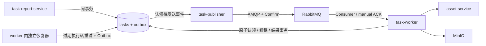

# AMQP Consumer、独立 Publisher 与 Worker 原子认领迁移方案

设计日期：2026-10-11；实现与验收更新：2026-10-12。已实施并完成本地验收，最终复验与逐项证据见 [AMQP 改造验收记录](amqp-worker-publisher-acceptance.md)。第 2 节“当前实现”保留改造前基线，不表示新代码仍采用旧链路。

## 1. 设计结论

将任务链路拆成三个可独立部署的进程：`task-report-service` 接收请求并写任务和 Outbox，`task-publisher` 通过 AMQP 发布 Outbox，`task-worker` 长连接订阅队列并执行任务。恢复器作为 worker 进程中的独立后台组件运行，不受任务处理循环阻塞，可多实例部署。

同一任务的执行权由 PostgreSQL 单条条件 `UPDATE … RETURNING` 原子认领，执行期间使用租约和每次执行唯一的 token。认领成功后立即提交数据库事务，再执行文件处理与远程调用；不持有贯穿整个任务的事务或 advisory lock。RabbitMQ 采用至少一次投递，资产写入保留唯一约束幂等，导出结果按执行 token 隔离。

“独占”定义为：数据库中同一任务最多一个有效执行者，只有这个执行者能够续租、更新进度、完成或安排重试。进程暂停、网络分区时，旧执行者已经发出的远程请求仍可能完成，因此还要保护业务副作用；单独一次任务认领不能撤回这些请求。

## 2. 当前实现与改造原因

| 位置 | 当前行为 | 改造要求 |
| --- | --- | --- |
| `platform/internal/taskcenter/broker.go` | Management HTTP API 建拓扑、发布、`/get` 拉取；`ack_requeue_false` 在业务处理前移除消息 | AMQP 订阅、手动 ACK、Publisher Confirm |
| `platform/internal/taskcenter/worker.go` 的 `cycle()` | 每 500ms 先发送 20 条 Outbox，再串行取最多 10 条消息执行 | 发布与执行分进程、分连接、独立生命周期 |
| `store_worker.go` 的 `Start()` | 已使用 `pending/failed → running` 条件更新，具备初步原子认领能力 | 加执行 token、租约、调度代次、到期时间、最大尝试次数校验 |
| `PendingOutbox()` | 直接 SELECT，多 publisher 会同时取到同一批 | 用短事务原子认领 Outbox，发布确认后有条件回写 |
| `Complete()` / `RetryOrDead()` | 只判断 `state='running'`，不校验执行者 | 防止租约过期的旧执行者修改新执行的状态 |
| `RetryOrDead()` / `PublishDead()` | 重试只在 Outbox 设置延迟；死信先写数据库再尽力直接发送 | 任务也保存下次执行时间；重试和死信均走事务 Outbox |
| `RecordImportRows()` | 每次重放 DELETE 全部任务行后 COPY | 保留已经提交的行，写入和进度更新均校验执行 token |
| `platform/internal/asset/batch_fast.go` | task advisory lock → 查幂等键 → 插资产 → 插幂等键 | 唯一键原子占位 → 仅处理占位成功的行，全批次同事务 |
| `platform/internal/asset/legacy.go` | 按旧记录键使用 advisory lock | 按已有 legacy 主键原子占位，移除第二处建议锁 |
| `service.go` 的导入预检 | 同步预检也使用 `running`，此时用户尚未确认执行 | 用调度代次明确区分预检与已调度任务，防止恢复器误执行 |
| `store.go` 的 `OpenStore()` | 只 embed 并执行 `001_init.sql` | 新增增量迁移入口，运行时连接数据库与执行 DDL 分离 |

## 3. 组件边界



| 进程 | 职责与依赖 |
| --- | --- |
| `task-report-service` | 授权、预检、确认、查询、取消、下载；写 tasks/Outbox；保留 API 需要的 IAM、资产、MinIO 依赖；不初始化 Broker |
| `task-publisher` | PostgreSQL + RabbitMQ；认领 Outbox、发布、处理 Confirm/Return、回写发送结果；不依赖资产服务和 MinIO |
| `task-worker` | PostgreSQL + RabbitMQ + 资产服务 + MinIO；消费、认领、执行、续租、写结果与重试/死信 Outbox；不直接发布消息 |

拆开当前 `Broker` 接口：发布接口只提供带确认的 `Publish`，消费接口提供订阅和绑定原 channel 的 delivery ACK/NACK；拓扑声明为独立可复用组件。`Worker` 不再依赖发布接口，删除 `cycle()` 中的 Outbox 发布逻辑和 `Get()` 轮询。

## 4. 表结构与消息契约

为 `task_report.tasks` 增加：

| 字段 | 用途 |
| --- | --- |
| `dispatch_version bigint NOT NULL DEFAULT 0` | 调度代次；0 表示尚未进入异步执行；首次执行为 1；重试和租约恢复递增 |
| `next_run_at timestamptz` | 本代任务最早可认领时间，统一使用数据库时间 |
| `worker_id text` | 实例启动时生成的唯一标识，用于归属和观测 |
| `execution_token uuid` | 每次认领重新生成，所有执行态写操作必须携带 |
| `lease_until timestamptz` | 执行权截止时间；续租只允许尚未过期的原执行者 |

任务内部读取结构和对外 API DTO 分开，执行 token 不加入公共 API。为 `running AND dispatch_version>0` 的租约扫描建立部分索引。

Outbox 增加 `dispatch_version`（普通执行事件使用）、`claimed_by`、`claim_token`、`claim_until`、`superseded_at`（切换时记录被新事件替代的旧事件）。保留现有 `available_at / attempts / published_at / last_error`。为 `task.requested` 建立 `(aggregate_id, dispatch_version)` 条件唯一索引，保证同一调度代次只有一条规范执行事件；同一事件的发送重试始终复用 `event_id`。旧事件的 dispatch_version 留空，避免伪造历史代次。

Inbox 继续使用 `(consumer, event_id)` 唯一键。`consumer` 是固定逻辑消费者名称，不使用每次启动变化的 `worker_id`；可增加处理结果字段用于区分成功、已安排重试与死信。非法消息单独存入 `message_quarantine`，避免无有效 task ID 的消息受 `dead_letters.task_id` 外键限制。隔离记录保存独立 UUID、原消息指纹、限长正文/元数据和原因；同指纹去重，关联的 dead Outbox 使用新 event ID 和隔离记录 UUID 作为 aggregate_id，payload 明确标识为消息隔离事件。

新消息格式示例：

```json
{
  "schema_version": 2,
  "event_id": "uuid",
  "task_id": "uuid",
  "kind": "import",
  "dispatch_version": 1
}
```

AMQP `MessageId` 与 `event_id` 相同；迁移兼容期继续携带已有 `event_id` header。消息只传标识，任务参数以数据库为准；校验 UUID、版本、类型及 task kind 一致性。`schema_version` 是消息格式版本，`dispatch_version` 是任务调度代次，两者职责不同。

导入只有 `ConfirmAndEnqueue()` 才将 `dispatch_version` 从 0 变成 1；导出在 `Create()` 中初始化为 1。字段更新和插入对应 Outbox 必须在同一事务。失败时进入现有 `failed` 状态并安排下次执行；同步修正 `CanTransition()`，与实际 `failed → running` 和 `running → dead_letter` 行为一致。

## 5. Worker 原子认领与执行权

用 `ClaimTask()` 替代 `Start()`。以下 SQL 是设计示意，参数依次为 task ID、消息代次、worker ID、新 token、租约时长：

```sql
WITH locked AS MATERIALIZED (
  SELECT id AS locked_task_id FROM task_report.tasks WHERE id = $1 FOR UPDATE
)
UPDATE task_report.tasks
SET state = 'running',
    attempt = attempt + 1,
    worker_id = $3,
    execution_token = $4,
    lease_until = clock_timestamp() + $5::interval,
    last_error = '',
    updated_at = clock_timestamp()
FROM locked
WHERE id = locked.locked_task_id
  AND dispatch_version = $2
  AND dispatch_version > 0
  AND state IN ('pending', 'failed')
  AND next_run_at <= clock_timestamp()
  AND attempt < max_attempts
  AND (kind = 'export'
       OR (kind = 'import' AND result @> '{"confirmed":true}'::jsonb))
RETURNING *;
```

返回一行才获得执行权，返回零行必须分类处理，数据库错误不能伪装成“任务已被认领”。认领仍是单条条件更新 SQL：锁定 CTE 不先判断任务可执行性，而是保证 SET 中的数据库时间在锁等待结束后计算，不需要 advisory lock。PostgreSQL 在并发更新后重新检查 WHERE 条件，因此两个 worker 竞争同一任务时只能有一个完成这次状态迁移。[PostgreSQL 16 并发更新语义](https://www.postgresql.org/docs/16/transaction-iso.html)

认领返回的内部 `Execution` 结构保存 task ID、worker ID、token、dispatch version 和租约。下列操作都要求 `state='running' AND execution_token=$token AND worker_id=$worker AND lease_until>clock_timestamp()`：

- `RenewLease`、进度更新；
- `RecordImportRows`、`MarkRowsCommitted`；
- `Complete`、`RetryOrDead`。

涉及多表的执行操作，在同一短事务中先以条件更新或行锁锁住并验证任务，再写入任务行、Inbox、Outbox 等；不能在事务外验 token 后另开事务写入，否则会产生检查与写入之间的接管窗口。任务行作为所有这些操作的统一锁顺序，网络调用不放进事务。

续租返回零行即 `ErrLeaseLost`，立即停止发起新的批次、取消执行 context；数据库连接异常且无法确认租约有效时也停止新增副作用。旧 worker 不能续活已经过期的租约，不能覆盖新 worker 的结果，也不能调用通用失败逻辑把新执行改成 failed。

建议初始配置：租约 90 秒，独立 goroutine 每 20 秒续租，恢复扫描每 10 秒一次；这些是待压测校准的参数。每个任务设置整体超时，例如初始 20 分钟。MQ heartbeat、数据库租约和消费 ACK 超时分别配置，三者不能互相替代。

保留当前“运行中不能取消”的 API 语义。本次给待执行状态的取消补充条件更新竞争测试；若以后支持运行中取消，再增加取消信号与 token 撤销流程。

## 6. AMQP 消费与 ACK 决策

采用 RabbitMQ 团队维护的 `github.com/rabbitmq/amqp091-go`，实施时固定与 Go 工具链、RabbitMQ 3.13 验证兼容的版本并提交 `go.mod/go.sum`。每个 worker slot 使用独立 channel 和 consumer，`autoAck=false`、`prefetch=1`；每进程初始 2 个 slot，可通过配置扩容。不同任务可并行，同一任务由数据库认领竞争决定归属。消费者使用普通共享队列订阅；不启用整队列 exclusive 或 single-active-consumer。

ACK 必须在接收消息的原 channel 上执行，使用单条确认 `multiple=false`。连接丢失后的未确认消息由 Broker 重投，应用需接受重复投递。[RabbitMQ 3.13 确认机制](https://www.rabbitmq.com/docs/3.13/confirms)

| 情况 | 数据库动作 | 消息处理 |
| --- | --- | --- |
| 认领成功、业务成功 | 同事务校验 token、写 succeeded/result、写 Inbox、清理租约 | 提交成功后 ACK |
| 可重试业务失败 | 同事务校验 token、写 failed、设置 next_run_at、代次 +1、新 Outbox、旧事件 Inbox、清理租约 | 提交成功后 ACK 旧消息 |
| 永久失败或次数耗尽 | 同事务写 dead_letter、dead_letters、dead Outbox、Inbox、清理租约 | 提交成功后 ACK |
| Inbox 已处理，或任务已成功/取消/死信 | 不重复执行 | ACK |
| 消息代次低于数据库代次 | 不允许旧消息认领新一轮任务 | ACK |
| 当前任务被有效租约持有 | 不增加 attempt、不执行业务 | ACK 重复通知；原执行继续，宕机则由恢复器重新生成通知 |
| 当前任务 running 但租约已过期 | 恢复器或共用恢复方法原子结束旧执行并写下一代 Outbox | 确认恢复事务已提交或观察到已完成恢复后 ACK |
| 同代次消息早于 next_run_at | 不认领，不算业务失败 | 保留未确认；关闭该 slot 的 channel，退避并在到期后重新订阅，避免即时重投循环 |
| 数据库不可用、事务提交结果不明 | 不认为成功，也不贸然安排另一轮失败 | 取消该 slot 执行并关闭 channel，退避重连；恢复后核实状态 |
| 非法格式、未知版本、未来代次、task 不存在或类型不匹配 | 同事务记录 quarantine 和 dead Outbox；原消息限长保存 | 持久化成功后 ACK；数据库失败则保留重投能力 |

对超过次数却仍在 pending/failed 的异常旧任务，走有条件的终止事务写 dead_letters 与 dead Outbox，再 ACK，不能无限重复投递。认领失败后的分类读取仍可能遇到并发状态变化：只对能确认的终态、旧代次或有效持有者 ACK，其余重新进入受控判断/恢复流程。

ACK 发送失败后不把已经成功的任务改为失败，重投由 Inbox/终态消重。`redelivered` 标志不作为唯一幂等依据。业务失败通过 Outbox 延迟重试，不用反复 `Nack(requeue=true)` 产生忙循环。

RabbitMQ 3.13 默认消费确认超时为 30 分钟。部署时明确校验它大于任务整体超时加收尾余量；超过现有上限的任务应调大队列策略或另行拆分任务。[RabbitMQ 3.13 Consumer timeout](https://www.rabbitmq.com/docs/3.13/consumers)

## 7. Publisher 与事务 Outbox

`Publisher.Run()` 独立扫描待发送事件。采用以下短事务模式认领，不能在等待网络 Confirm 时一直持有数据库事务：

```sql
WITH candidates AS (
  SELECT id
  FROM task_report.outbox
  WHERE published_at IS NULL
    AND superseded_at IS NULL
    AND available_at <= clock_timestamp()
    AND (claim_until IS NULL OR claim_until <= clock_timestamp())
  ORDER BY available_at, id
  FOR UPDATE SKIP LOCKED
  LIMIT $1
)
UPDATE task_report.outbox o
SET claimed_by = $2,
    claim_token = $3,
    claim_until = clock_timestamp() + $4::interval
FROM candidates c
WHERE o.id = c.id
RETURNING o.*;
```

`SKIP LOCKED` 只用于批量认领 Outbox 和恢复扫描；它适合多个处理者竞争队列表记录。这里是数据库短事务行锁，不是建议锁，也不覆盖业务执行时间。[PostgreSQL SELECT 文档](https://www.postgresql.org/docs/16/sql-select.html)

发送约定：

1. publisher 使用独立 AMQP connection 和 confirm channel；声明 durable exchange、queue、binding，发送持久消息。
2. 开启 `mandatory=true`，同时监听 Confirm、Return 和 channel/connection close；`Publish` 返回 nil 不代表事件已可靠发送。
3. 只有确认 ACK 且该消息未被 Return，才按 `id + claim_token + claimed_by + 未过期 claim_until + 未被替代` 条件写 `published_at`。NACK、Return、超时或连接中断均保留事件，按退避重试；失败回写同样校验认领权，再增加发送 attempts、设置 available_at 并清理认领。过期发送者不得修改新认领者的状态。
4. 初版每个发送 channel 只保留一条未确认消息，认领量不超过空闲发送 slot；避免先认领 20 条再逐个等待导致后面的租约过期。初始发送租约 30 秒、确认上限 10 秒，发送卡死必须能关闭连接解除阻塞。
5. `topic` 决定 exchange/routing key：`task.requested` 发工作队列，`task.dead` 发死信队列；删除 Worker 的 `PublishDead()` 直发路径。
6. Confirm 成功但写数据库前崩溃，允许同 event ID 再次发送。Outbox 认领降低并发重复，不宣称 exactly-once。

AMQP 客户端将 Return 和 Confirm 暴露到不同 Go channel，不能把 `select` 先收到 Confirm 等同于“没有 Return”。发送适配层要对固定库版本验证通知顺序和缓冲行为，关联 MessageId/发送序号；接到 Confirm 后先归集该消息此前的 Return 再做成功判定。初版单条在途用于简化关联，必须用不可路由的真实 Broker 用例验证该判定。[amqp091-go 官方说明](https://github.com/rabbitmq/amqp091-go)

## 8. 租约恢复、重试与状态隔离

每个 worker 进程运行独立恢复循环。用 `FOR UPDATE SKIP LOCKED` 选择 `dispatch_version>0 AND state='running' AND lease_until<=数据库时间` 的有限批次，在同一事务中重新检查当前租约：

- 尚有尝试次数：结束过期执行，状态改为 failed，清理 worker/token/lease，递增 dispatch_version，写 next_run_at 和下一代 Outbox。
- 已耗尽：状态改为 dead_letter，同时写数据库死信和 dead Outbox。

只有成功 Claim 增加 `attempt`。租约过期消耗的是已认领的那次尝试；恢复器不额外加一次，重复通知与 publisher 发送重试也不计入业务尝试次数。保留默认 `max_attempts=3`，表示最多执行三次。

恢复器不直接执行任务，不直接发布 MQ。同一过期任务只会有一个恢复事务成功改变状态，Outbox 的代次唯一键再防止重复安排。即使所有 worker 暂时停止，持久任务仍保留，任一 worker 恢复后继续扫描。

导入预检保持 `dispatch_version=0`，不在异步认领和租约恢复范围内。将同步预检的 `Transition/FailPermanent` 收紧到该阶段；删除或限制 `FailOrRetry` 等不带 token 的通用执行状态写入口。预检中断的修复只重新预检或标记预检失败，不能自动跳过用户确认去写资产。

## 9. 移除建议锁后的副作用保护

### 9.1 资产批量写入

将 `CreateBatchFast()` 改为批量实现当前 `CreateBatch()` 已采用的“先原子占幂等键，再写资产”模式：

1. 验证整批字段；同批 row key 重复直接拒绝；按 row key 固定排序，降低多个重叠批次的锁顺序冲突。
2. 为候选行生成 asset ID，在同一事务里批量执行：

   ```sql
   INSERT INTO asset.import_idempotency
     (task_id, row_key, asset_type, asset_id)
   VALUES ...
   ON CONFLICT (task_id, row_key) DO NOTHING
   RETURNING row_key, asset_id;
   ```

3. 只为 RETURNING 返回的行批量插入资产与版本快照，其余记为 skipped。
4. 幂等占位、资产、版本一起提交；任何一步失败全部回滚。不会留下“占位成功却没有资产”的已提交状态。

删除 `pg_advisory_xact_lock` 和先查再判定的并发控制路径。唯一键才是最后的并发写入约束；`ON CONFLICT … RETURNING` 返回实际插入的行。[PostgreSQL INSERT 文档](https://www.postgresql.org/docs/16/sql-insert.html)

导入源文件、任务所属资产类型和 row key 映射在确认后保持不变。资产接口超时不等于事务未提交，worker 重试相同 row key 即可安全重放。任务行记录用 COPY 到 staging 后按唯一键合并，保留 committed_at，不再 DELETE 已有进度；合并和进度标记都需在持有有效 token 的短事务里完成。结果同时区分“本次 created/skipped”和“任务累计 committed”，避免崩溃重放后误报整个任务创建 0 行。

### 9.2 导出文件

把固定 `exports/{task_id}.csv` 改成 `exports/{task_id}/{execution_token}.csv`。上传完成后，只有持有有效 token 的完成事务能把这个 key 写入任务结果；下载始终读取任务结果里的 key。旧执行者晚到的上传只产生无人引用的对象，不会覆盖新结果，沿用 `exports/` 生命周期清理。

### 9.3 历史迁移入口

`CreateLegacy()` 不由本 worker 消费链路驱动，因此 worker 认领不能覆盖它。按现有 `(legacy_type, legacy_id)` 主键先 `INSERT … ON CONFLICT DO NOTHING RETURNING` 占位，再在同事务写资产与版本；冲突方在后续查询读取已存在映射及资产。移除该处 advisory lock，一并跑历史迁移幂等回归。

本方案保障任务状态提交的唯一执行权，以及当前导入/导出的幂等或隔离副作用。它不保证租约切换瞬间只有一个操作系统进程在运行。如果未来加入非幂等外部操作，必须在目标服务实现可校验的执行代次/幂等键，不能只依赖 task_report 的 token。

## 10. 拓扑、生命周期与部署

沿用 `asset.tasks`、`task-report-worker`、`asset.tasks.dead`、`task-report-worker.dead`，保持现有队列声明参数兼容。本次先保留当前队列类型，不在同名现存队列上改变 `x-queue-type` 或其他不兼容参数。

当前工作队列指定 dead exchange，却没有设置 dead routing key；原消息 routing key 为 `task.requested`，dead queue 只有 `task.dead` 绑定。补充 dead queue 对 `task.requested` 的绑定以接住 Broker DLX 路径，保留 `task.dead` 绑定。正常业务死信与非法消息采用数据库落盘 + Outbox 发布，不能把 classic queue 的 DLX 当成唯一可靠记录。[RabbitMQ 3.13 DLX 路由与可靠性](https://www.rabbitmq.com/docs/3.13/dlx)

应用 supervisor 负责连接生命周期，断线后以退避和抖动重建连接、channel、拓扑、Qos、Confirm 和订阅。明确所选库版本提供的恢复能力，避免应用与库同时创建重复订阅。旧 channel 的 delivery 不得交给新 channel ACK；断线取消对应执行 context，停续租后由恢复器处理未完成执行。

SIGTERM 流程：先置为 not-ready，停止接收新消息；保持处理中任务的执行 context 和续租，等待有界 drain；成功提交的正常 ACK。超过停机时限再取消任务、关闭 channel 让未确认消息重投，等待 goroutine 退出后关闭数据库。不要像当前入口那样把接收 SIGTERM 的 context 直接当作所有处理中任务的取消信号。初始 drain 60 秒，Compose `stop_grace_period` 至少 75 秒。

Compose 新增 `task-publisher` 和 `task-worker`，复用现有 Dockerfile 的 `SERVICE` 构建参数。移除 API 对 Broker 的启动依赖，缩小每个进程的依赖和环境变量：业务运行只使用 `RABBITMQ_URL`；Management API 可留给管理界面和只读监控。可扩容的 worker 不映射固定宿主端口、不配置固定 container_name。

API readiness 检查自身必要依赖；publisher readiness 检查数据库和发布 channel；worker readiness 检查数据库、订阅和必要执行依赖。日志至少携带 task_id、event_id、dispatch_version、worker_id、execution_token。监控 Outbox 最老待发时间、Confirm/Return 失败、claim 冲突、租约过期次数、执行耗时、待确认消息数和死信数。

## 11. 实施顺序和文件范围

| 步骤 | 主要修改 | 完成条件 |
| --- | --- | --- |
| 1. 数据模型与执行权 | 新增 `taskcenter/migrations/002_amqp_execution.sql`；改 `store.go/model.go`；新增 `store_execution.go` | 增量迁移可重入，Claim/续租/完成/重试/恢复均校验 token 与代次；旧通用写入口不能绕过 |
| 2. 副作用幂等 | 改 `asset/batch_fast.go`、`asset/legacy.go`、`taskcenter/worker.go` 与任务行存储 | 两处建议锁移除，并发重放无重复资产；旧导出不能覆盖新结果 |
| 3. AMQP 适配与 publisher | 替换 `broker.go`，新增 `broker_amqp.go/publisher.go/store_outbox.go`、`cmd/task-publisher` | Confirm + Return、Outbox 认领及重连通过真实 Broker 测试 |
| 4. Consumer 与恢复器 | 改 `worker.go/store_worker.go`，新增 `recovery.go`、`cmd/task-worker` | 手动 ACK、有限并发、租约恢复和停机闭环通过故障测试 |
| 5. 部署与迁移 | 简化 `cmd/task-report-service`，更新 `compose.yaml/.env.example` 与冒烟脚本 | 三进程独立启动，API 不运行内嵌 worker，扩容无任务重复副作用 |
| 6. 验收与文档 | 更新架构说明、阶段三总结、改造状态和相关面试文档 | 文档中的实现状态与代码一致，保留真实验收记录 |

数据迁移通过单独的 migrate-only 启动模式执行一次，应用运行时只打开连接并检查 schema 版本；不要让三个进程同时在 `OpenStore()` 里运行 DDL，也不要引入迁移 advisory lock。新增迁移登记机制并保留原 `001_init.sql`；如维护 deploy 下的迁移镜像文件，同步内容并检查一致性。

## 12. 切换和回退

当前版本先取走消息再执行业务，不适合与新 consumer 无约束混跑。采用受控短暂停机切换：

1. 停止接收新的创建/确认请求，让旧 worker 尽量完成当前任务，再停止全部旧 task-report-service 实例；确认没有旧执行进程存活，保留数据库与队列数据。
2. 执行增量迁移，盘点未终结任务；终态不重新调度。导出以及 `result.confirmed=true` 的导入归为可执行任务；未确认预检和待确认导入单独处理。
3. 对可执行的 pending/failed 和已停旧进程遗留的 running，在事务中规范状态、初始化调度代次和 next_run_at、清空执行权并确保有一条对应 Outbox。保留 attempt；已耗尽的写死信。旧未发送事件标记为被新事件替代，不伪装成 published 成功。
4. 已在 Broker 中的旧消息没有 dispatch_version：仅在切换兼容窗口，通过旧 Outbox 的 event_id、task_id、kind 校验身份，并确认数据库中已有新的执行事件或终态后 ACK，不直接映射到当前代次执行。异常旧消息进入隔离记录。
5. 先启动新 publisher，再启动一个 worker slot，验证导入、导出、重投与恢复，再开放 API 创建/确认并逐步扩容。稳定后关闭旧格式兼容入口。

历史预检 `running` 且未确认的任务不得因“恢复 running”被执行；需重新预检或明确标记预检中断。已经被旧 HTTP consumer 提前移除的消息，由第 3 步从数据库任务重建触发通知。

回退时优先停止新 worker/publisher、保留任务与 Outbox、修复后继续；不可直接把已参与新 token/代次流程的数据交给旧版无 token Worker。若必须回退消费者，需先停止全部新执行者并完成数据与队列格式转换，不回滚已提交资产或删除持久卷。

## 13. 必须通过的验收

| 场景 | 预期结果 |
| --- | --- |
| 多 worker 同时收到同任务同代次通知 | 只有一次 Claim 成功、attempt 只增加一次 |
| 不同任务并行执行 | 受 slot 限制并行，同任务不靠建议锁串行化 |
| Claim 后杀死 worker | 租约到期后自动产生下一代事件并恢复，超过次数进入死信 |
| 成功提交后、ACK 前断线 | 消息重投被消重，任务保持 succeeded |
| 资产批次提交后 HTTP 响应丢失 | 重放相同行键不增加资产和版本，累计进度正确 |
| 旧 worker 暂停后恢复，新 worker 已接管 | 旧 token 的续租/进度/Complete/RetryOrDead 全部失败 |
| 旧导出请求晚完成 | 不覆盖新执行的对象及下载结果 |
| Outbox Confirm 后、回写前杀 publisher | 同 event ID 可重发，无重复业务结果 |
| 多 publisher 竞争、旧发送者晚回写 | 认领互斥，旧 claim token 不可标记新认领事件 |
| 路由不存在、Broker NACK、Return 与 Confirm 紧邻到达 | 事件不被错误标记已发送，持久保留并重试 |
| 重试退避期间收到旧消息 | 不绕过 next_run_at，不消耗下一次 attempt |
| PostgreSQL 或 RabbitMQ 中断 | 不提前 ACK，不形成即时重投忙循环；恢复后重新订阅/续派发 |
| 失败/死信事务提交后立即退出 | 下一次执行或 dead 通知仍由 Outbox 发布 |
| 非法消息及不存在的 task ID | 持久隔离，不反复占用 worker，不因 dead_letters 外键而丢记录 |
| 同步导入预检 running、尚未确认 | 恢复器不调度资产导入 |
| 重叠批次及并发 legacy 请求 | 无 advisory lock 仍不重复写入；事务失败不残留占位 |
| SIGTERM、优雅退出与强制超时 | 停止新认领，已完成任务正常 ACK，未完成任务可恢复 |
| worker 执行慢任务时创建新任务 | publisher 仍继续派发，不被执行循环阻塞 |

执行 Go 单元测试、真实 PostgreSQL + RabbitMQ 集成测试，以及现有 Compose 冒烟、10 万行导入和历史迁移回归。迁移任务涉及并发与崩溃语义，不能只保留当前 httptest 模拟 Management API 的测试。性能以新实测记录为准，不沿用旧耗时作新方案的验收结论。
