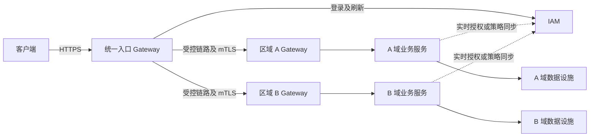

跨网段部署、Gateway 与 IAM 改造调研

调研日期：2026-10-20。范围：当前工作区中的 Go 平台代码、Compose 配置及官方技术资料。本文为设计建议，未启动分网段环境、注入故障或完成跨机实测。

这里把“跨端”理解为跨主机、跨网段或跨园区部署。如果只是浏览器、桌面端、移动端接入同一后端，主要变化是客户端登录流程与令牌存储，不必因此拆分后端网段。

结论：可以用 Docker Compose 的多个 bridge 网络与不同 subnet 做第一阶段验证。网络可达性、应用路由和身份权限必须分别设计；修改 Gateway 的 upstream 地址，不能自动提供跨网段路由、数据隔离或权限隔离。

结合项目规模，建议先完成单 Gateway 的分网段部署和服务身份改造；确实存在多个独立园区、安全域或故障域后，再引入各域 Gateway。IAM 先保持实时授权语义，测出跨网段延迟与可用性影响，再决定哪些操作允许本地授权。

以下关于架构、缓存时间和故障处理的具体选择是本项目建议，并非 Docker 或 OAuth 标准强制要求。

当前实现中与本次部署直接相关的事实如下。

| 位置 | 当前行为 | 跨网段部署的影响 |
| --- | --- | --- |
| `platform/cmd/gateway/main.go` | 按 `/api/v1/...` 前缀转发到四个固定配置的 upstream；没有用户认证中间件 | 支持修改 URL，但尚无按站点选择路由、站点权限校验或域间服务身份 |
| `platform/internal/asset/auth.go` | 每次授权请求远程调用 IAM 的 `/api/v1/auth/authorize`，客户端总超时为 5 秒 | IAM 链路进入业务请求的同步关键路径 |
| `platform/cmd/task-report-service/main.go` | 复用资产模块的 IAMAuthorizer | 任务 API 同样依赖 IAM 连通性 |
| `platform/internal/iam/service.go` | 验签后查询用户当前状态及 `permissions_version` | 能在后续授权时发现禁用和权限版本变更，但需要 IAM 及数据库可用 |
| `platform/internal/iam/token.go` | RS256；校验 issuer、audience、到期时间；当前签名头没有 `kid`，验签对象和签名私钥绑定 | 本地公钥验签与密钥轮换需要拆出独立能力 |
| `platform/cmd/iam-service/main.go` | 未配置私钥时生成临时 RSA 密钥 | 当前 Compose 没有挂载固定签名密钥；重启会改变密钥，简单扩成多副本会产生相互不认令牌的问题 |
| `platform/internal/asset/internal_http.go` | 内部接口只校验共享 `X-Internal-Token`，接受调用者给出的 `global`、部门范围和敏感字段开关 | 共享密钥持有者可以提出很宽的数据范围，缺少逐调用者、逐操作的权限限制 |
| `platform/internal/taskcenter/service.go`、`worker.go` | 创建任务时保存授权范围；执行导出时从任务输入恢复范围 | 需定义任务排队期间撤权后，是否仍允许执行；当前执行路径未重新查询 IAM |
| `compose.yaml` | 未显式配置 networks，服务使用默认网络；多服务共用数据库凭据，部分服务继承 bootstrap 密码、MinIO root 凭据和内部令牌 | 单纯增加 subnet 仍不能解决共享凭据和数据库权限边界问题 |

`governance-service` 当前是工程基线占位进程，不能把它视为已经具有与资产服务相同的权限实现。

网络设计应先确定谁需要访问谁。

同一受控内网的多个子网，可以采用一个具备高可用能力的入口 Gateway。操作系统路由、VPN、云网络互联及防火墙保证它能访问各域入口；Gateway 按固定配置做 HTTP 转发。容器名在 Compose 网络中有效，跨主机后需要改为实际可解析的服务域名或负载均衡地址。

如果有多个独立园区或云与本地机房，适合采用下面的逻辑拓扑。每个 Gateway 框代表可部署多个实例的逻辑组件。



各域网关只开放本域允许的 API；数据库、消息队列和管理接口保留在对应数据域。域内服务调用可直接使用受保护的内部入口，不要求所有请求绕回外部 Gateway。如果中央入口中断后园区仍需独立使用，还必须提供本地客户端入口、DNS、必要的本地数据及明确的离线授权方案；增加区域 Gateway 本身不等于离线可用。

如果边缘网络只允许向外建立连接，需要由边缘主动建立受认证的隧道或采用消息任务方式。中央 Gateway 不能凭配置直接访问 NAT 后未开放的服务。

建议的访问矩阵如下；这是逻辑允许方向，需要防火墙、代理策略或其他网络策略落实。Compose 共同网络成员之间的连通性本身没有这种单向含义。

| 发起方 | 目标 | 允许内容 |
| --- | --- | --- |
| 浏览器/客户端 | Web 或入口 Gateway | HTTPS；统一域名下提供前端与 API |
| 入口 Gateway | IAM 对外入口、各域 API 入口 | 固定路由和指定端口 |
| 资产服务、任务 API | IAM 内部授权入口 | 经过服务身份认证的授权请求 |
| 任务 API | 资产内部入口 | 统计等实际需要的操作，按调用者收窄 |
| Worker | 资产内部入口 | 有效任务委托范围内的导入、导出 |
| 各业务服务 | 所属数据库 | 独立数据库账号和相应 schema 权限 |
| Publisher、Worker | RabbitMQ | 独立账号、vhost/队列权限；生产使用加密连接 |
| 任务 API、Worker | 对象存储 | 独立凭据及桶/对象前缀权限 |
| 运维入口 | 管理接口、诊断接口 | 独立访问路径，不通过公共业务路由 |

子网之间配置默认拒绝，只开放矩阵中的目标、端口和方向。避免不重叠地址规划被遗漏，也要检查企业 VPN、宿主机、云 VPC 与容器 CIDR 的冲突。若最终使用 Kubernetes，NetworkPolicy 需要支持它的网络插件才能生效，不能只创建策略对象便认定隔离完成。[Kubernetes 官方说明](https://kubernetes.io/docs/concepts/services-networking/network-policies/)

Gateway 需要改进的主要是路由边界和故障边界。

- 从“每个服务一个 URL”逐步演进为受控路由表，例如“站点 + API 前缀 → 区域入口”。只由运维配置维护目标白名单，不能把客户端传入的任意 URL 当 upstream。
- 如果站点对应权限边界，先校验用户可访问的站点，再选择路由；区域服务还应独立校验所属站点。不能只凭 `X-Site-ID` 或来源 IP 授权。
- 对外 HTTPS；域间及敏感服务调用采用 mTLS，验证证书链、服务名称与调用者身份。当前 `servicekit.Run` 使用普通 HTTP，可通过应用 TLS 配置或受控代理逐步实现。
- 在可信入口清理外部注入的身份头和内部令牌头；`Forwarded`、`X-Forwarded-*` 只信任确定的代理链。当前代码清理 `Origin` 是 CORS 行为，不构成身份边界。
- 为连接、TLS 握手、等待响应头及整体请求分别设定预算；与服务端当前 30 秒读写超时协调。普通 API 与大文件传输采用不同预算。
- 按区域限制并发、连接池和失败重试，避免区域 A 超时占满全局资源。读请求可按策略重试；写请求必须有幂等保障才能自动重试。
- 保留 request ID，增加区域、调用服务、授权耗时、超时和拒绝原因的可观测性。鉴权依赖故障与凭据错误应区分为可用性错误和 401/403。
- 公共路由只开放必要 API，内部授权及 `/internal` 接口采用独立入口或显式路由限制。现有 `/api/v1/auth` 前缀会覆盖 `/authorize`；收拢它之前需核对客户端依赖。

IAM 应区分用户身份、服务身份和具体资源权限。

Gateway 适合做身份初筛、路由访问检查和限流；业务服务负责操作权限、部门/所有者范围、敏感字段和对象归属检查。网关通过检查后，业务服务仍应验签或验证具有明确受众的可信签名上下文。不要把客户端可伪造的明文身份头当作权限依据。

项目已有部门和所有者范围，应继续由业务查询落实。只有不同站点确实代表资源或租户边界时，才增加 `site_id`、`tenant_id` 及相应授权关系，并让查询、按 ID 读取、统计、导入导出、任务与对象存储访问一致遵守该边界。网络地址不应成为租户身份。

关于远程 IAM 与本地验签，可以分阶段选择：

| 方案 | 优点 | 成本及语义 |
| --- | --- | --- |
| 保持每次远程授权 | 保留当前实时用户状态和权限版本检查，改动较小 | 请求依赖 IAM 链路；优先解决链路、超时和高可用 |
| 本地验签，授权仍远程查询 | 可以提前拒绝无效令牌，为后续优化做准备 | 合法请求仍需要跨网段访问 IAM，不应宣称已经消除延迟 |
| 本地验签与本地策略/授权缓存 | 减少同步跨域调用，部分请求可在限定条件下继续服务 | 引入撤权传播延迟、缓存过期及分区期间的一致性问题 |

本地验签需要独立的公钥 verifier、可信 issuer 配置、JWKS 分发与缓存、`kid` 密钥选择和轮换机制。校验允许的算法、签名、issuer、audience、有效时间与令牌用途。公钥可以分发，签名私钥保留在受控签发端；不要为了让服务验签而把 IAM 私钥复制给业务服务。未知 `kid` 可触发受限刷新，仍无法匹配则拒绝；不能根据不可信令牌里的 URL 任意下载公钥。[JWT 安全实践](https://www.rfc-editor.org/rfc/rfc8725.html)、[JWK 标准](https://www.rfc-editor.org/rfc/rfc7517.html)

**本地 JWT 验签成功，只能证明令牌满足所检查的签名和声明条件，不能证明用户此刻没有被禁用。**

当前实时 `permissions_version` 检查不能仅靠 JWT 中同名字段替代，必须有可信的当前版本来源。建议保留高敏感操作的在线检查；低风险读取如允许缓存，可先以几十秒的可配置新鲜度窗口作为测试参数，再用业务要求确定最终值。缓存键至少区分令牌/会话、操作、资源域和策略版本，不能只按用户 ID 缓存“允许”。

缓存不能超过令牌有效期；部门树、角色策略、站点授权变化同样需要使相关缓存失效。采用事件通知时，还要有版本校验、定期对账和漏事件恢复。副本读取也需明确复制延迟对撤权生效时间的影响。OAuth 的 introspection 标准明确指出，缓存会在性能和信息实时性之间引入取舍；本项目当前 `/authorize` 是自定义协议，并非已经实现了该标准接口。[RFC 7662](https://www.rfc-editor.org/rfc/rfc7662.html)

网络分区时无法同时保证“中心刚撤权就立刻生效”和“所有离线请求持续可用”。建议默认规则是：必须实时确认权限的操作，在 IAM 不可达时不执行业务动作，返回明确的依赖不可用错误；仅对事先定义的低风险读取允许使用仍在新鲜度窗口内的缓存，过期后拒绝。不能在远程授权超时后直接放行。

服务身份方面，首先替换所有服务共用的 `INTERNAL_SERVICE_TOKEN`。

- 每个服务有独立工作负载身份，可采用 mTLS 证书配合服务 ACL，或有受众、操作范围和短有效期的服务令牌。
- mTLS 证明调用方持有对应身份凭据；目标服务仍须判断该身份能调用哪些接口。网络通、证书有效，都不等于有任意数据权限。
- 例如 Worker 只能调用资产导入导出相关内部操作；Publisher 无须获得资产内部接口凭据。
- 用户委托的任务同时限制“服务允许的操作”和“原用户允许的数据范围”。任务关联 `task_id`、请求者、站点/租户、资源范围、权限版本及委托有效期；由可信服务签发或通过受保护的任务记录核验，不能让调用方自行扩大 `global` 范围。
- 异步任务无需长期保存浏览器 access token。执行前获取新的短期委托或重新授权；明确权限撤销后排队任务、运行中批次和已生成文件如何处理。长任务按检查点重新确认，不能把创建时授权永久沿用。
- 将 IAM bootstrap 密码只提供给 IAM 初始化环节；数据库使用独立运行账号，迁移账号分离；MinIO 使用受限业务凭据；RabbitMQ 按实际发布/消费权限分离账号。

若采用 OAuth 的证书绑定令牌，需要同时实现令牌与证书绑定验证；单纯启用 HTTPS 或普通 mTLS，并不会自动获得证书绑定令牌的防转用效果。[RFC 8705](https://www.rfc-editor.org/info/rfc8705/)

Docker 测试可以分两层进行。

第一层验证一个 Gateway 访问多个隔离网络。下面只展示网络骨架，**不是完整可运行 Compose，也不是可直接叠加当前文件的 override**；构建、环境变量、数据库、任务链路和健康检查需要一并补齐。

```yaml
services:
  gateway:
    networks: [edge, iam_api, asset_api]
    ports:
      - "127.0.0.1:18080:8080"

  iam-service:
    networks: [iam_api, asset_iam_rpc, iam_db]
    # 不发布宿主端口

  asset-service:
    networks: [asset_api, asset_iam_rpc, asset_db]
    environment:
      IAM_SERVICE_URL: http://iam-service:8081
    # 不发布宿主端口

networks:
  edge:
    driver: bridge
    ipam:
      config: [{subnet: 172.28.10.0/24}]
  iam_api:
    driver: bridge
    internal: true
    ipam:
      config: [{subnet: 172.28.20.0/24}]
  asset_api:
    driver: bridge
    internal: true
    ipam:
      config: [{subnet: 172.28.30.0/24}]
  asset_iam_rpc:
    driver: bridge
    internal: true
    ipam:
      config: [{subnet: 172.28.40.0/24}]
  iam_db:
    internal: true
  asset_db:
    internal: true
```

这些 CIDR 只是示例，使用前必须确认无地址冲突。关键是创建不同网络并限制成员，单独更换 IP 数字没有足够的隔离意义。Gateway 同时加入所需 API 网络后能发起应用代理请求，不代表它应被配置成允许任意 IP 转发的路由器。[Compose 网络配置](https://docs.docker.com/reference/compose-file/networks/)

显式保留 `asset_iam_rpc`，是因为当前资产服务必须访问 IAM。也可以用只开放授权接口的内部代理替代这条直接连接，但必须相应修改 `IAM_SERVICE_URL`。仅把 IAM 和资产放到不同网络而不提供授权路径，结果是资产 API 授权失败。

补齐全项目时，可按以下连接关系扩展：

- Web 只与 Gateway 共享入口网络。
- Gateway 分别与任务 API、治理 API 共享各自 API 网络。
- 任务 API 与 IAM 建立单独授权网络或经过内部授权代理。
- 任务 API/Worker 与资产建立所需内部 API 网络或受限代理入口。
- Publisher/Worker 与 RabbitMQ 共享消息网络；任务 API/Worker 与 MinIO 共享对象网络。
- IAM、资产和任务域各有数据网络及数据库账号；任务迁移进程只进入任务数据网络。

如仍使用同一个 PostgreSQL 容器，可让它加入多个数据网络完成第一阶段验证，但所有业务共用一个 `data_net` 会重新提供业务间直接互访路径。数据库容器加入多个网络也使其成为共享信任点；这不是独立数据库或独立主机故障域的验证。

同一 bridge 网络的成员通常可以访问彼此监听的所有容器端口；`expose` 不是端口 ACL，`internal: true` 也不是应用鉴权或单向防火墙。若服务监听所有接口，公开和内部接口在共同网络上都可能可达；严格隔离应采用不同监听入口、受限代理或网络策略。[Docker bridge 文档](https://docs.docker.com/engine/network/drivers/bridge/)

减少宿主机 `ports` 映射非常重要。当前 PostgreSQL、RabbitMQ 与 MinIO 的映射应在隔离实验配置中移除，管理访问另行提供。否则可能通过宿主机的已发布端口形成替代路径。若确需本机调试，绑定回环地址并验证实际访问范围；不要据此认为宿主机管理员也被网络隔离。[Docker 端口发布说明](https://docs.docker.com/engine/network/port-publishing/)

建议建立独立测试 Compose 项目、独立数据卷和测试账号，并检查最终合并配置；不要直接拆改正在使用的网络与数据。验证 DNS 之外，还要直接针对已知 IP 和 TCP 端口测试，避免把“名称无法解析”误当作完整网络隔离。

第二层验证多个区域 Gateway。增加一个区域间 transit 网络，各区域 Gateway 连接 transit 与自己的业务网络，中央入口只连接 transit 和入口网络；业务服务不直接加入 transit。IAM 流量必须通过被明确允许的入口；可用受限代理为授权链路提供单独的故障注入点。

用 Toxiproxy 在 Gateway→区域入口、服务→IAM、Worker→资产、Worker→RabbitMQ 等 TCP 链路中注入延迟、带宽限制和连接中断。仅拆 subnet 不会模拟 WAN 延迟。需要真正的 IP 丢包、重排或 MTU 测试时，在专用 Linux 网络实验环境增加相应工具；Toxiproxy 是 TCP 代理，不是完整三层网络模拟器。[Toxiproxy 官方仓库](https://github.com/Shopify/toxiproxy)

建议的测试验收如下。表中数值是故障注入样例，不是实测结果或性能承诺。

| 场景 | 核心预期 |
| --- | --- |
| 从入口网络直连数据库、MQ 管理端口和内部 API | 不存在未授权访问路径 |
| 从 Gateway 正常访问各域 API | 路由正确，认证、数据范围和跨服务调用均成功 |
| 仅修改服务 IP，保留 DNS 名称并重建连接 | 服务能通过名称重新连接，不依赖固定容器 IP |
| 客户端伪造身份头、站点头和内部令牌头 | 不能改变已验证身份或扩大访问范围 |
| 令牌篡改、过期、错误 issuer/audience、未知密钥 | 拒绝请求，业务动作未执行 |
| 同一用户切换到未授权部门/站点、猜测对象 ID | 列表、明细、统计、任务和导出均保持隔离 |
| 使用 Publisher 身份调用资产导出 | 即使网络可达也被拒绝 |
| 创建导出任务后撤销用户权限，再执行任务 | 严格符合已定义的任务撤权规则 |
| IAM 链路增加 50/150/500 毫秒延迟或中断 | 观察业务 P95/P99、IAM 授权占比、超时数；无超时自动放行 |
| 区域 A 中断，区域 B 正常 | B 不被 A 的连接、线程/协程或队列占满 |
| IAM 密钥轮换及多副本滚动重启 | 有效旧令牌在预定过渡窗口可用，新令牌可被所有接收方验证 |
| 权限失效事件丢失、重复、乱序 | 能通过版本规则及对账恢复，满足撤权时间上界 |
| Worker 中途断网、消息重投、响应丢失 | 现有幂等、租约与确认机制仍有效，不产生重复写入 |
| 文件上传下载遭遇慢链路 | 超时预算明确，无意外重复执行或权限失效后继续任意下载 |

Docker bridge 主要覆盖单主机网络实验。真实跨主机部署还需验证底层路由、VPN、DNS、MTU、证书域名与链路故障。可在两台机器上通过受控路由连接各自 Compose 环境，或使用适合实际运行环境的编排网络；Docker overlay 跨 Docker 主机使用时需要 Swarm，即使连接的是 standalone 容器，也不是在普通 Compose 中换一个驱动名就完成部署。[Docker overlay 文档](https://docs.docker.com/engine/network/drivers/overlay/)

在 Windows Docker Desktop 的 Linux 容器模式下，Docker 网络位于 Linux VM/WSL2 环境中，还会经过 Desktop 的端口转发路径。因此本机实验应主要从容器内部验证容器间访问，并单独测试宿主与外部访问；它不能代替真实园区或云网络验收。[Docker Desktop 网络说明](https://docs.docker.com/desktop/features/networking/)

建议实施顺序：

1. 梳理访问矩阵，建立独立分网段实验配置；先保持现有实时 IAM 授权，确保业务链路完整。
2. 固定并管理 IAM 签名密钥；拆分数据库、对象存储、MQ 和内部服务凭据；为跨域链路加 TLS/服务身份。
3. 收紧 Gateway 公共与内部路由，增加超时、按域并发隔离、审计；服务端执行细粒度资源权限。
4. 运行断网、延迟、撤权和异步任务用例，测量 IAM 调用对业务延迟的实际贡献。
5. 如数据证明有必要，再引入 JWKS、本地策略和有明确撤权时间上界的缓存；存在独立站点时增加区域 Gateway 和站点资源边界。
6. 在至少两台真实主机或目标云网络中完成最终验收，再讨论生产切换。
