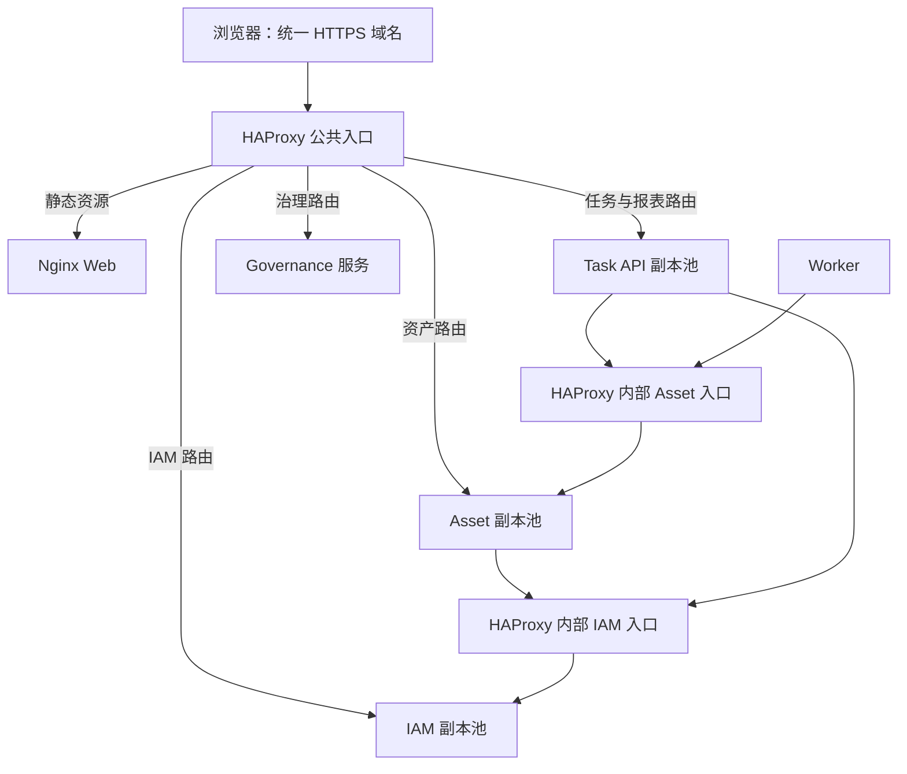

# HAProxy 与 Nginx：本项目负载均衡选型

日期：2026-10-24。状态：建议，尚未实施。范围：当前新平台的 HTTP 入口、业务服务副本调度和服务间 HTTP 调用；基于源码与官方资料比较，没有执行两者的性能对测。

**推荐 HAProxy Community 承担 API 入口和内部服务负载均衡，保留现有 Nginx 托管前端静态资源；兼容验证后移除纯转发 Go Gateway。** 优先级依据是：当前使用 Compose，希望主动检查 `/health/ready`、支持发布时逐实例摘流，并能观察每个后端的状态；默认使用开源组件，不引入商业订阅或自研健康调度器。

Nginx OSS 同样能够完成反向代理与多实例分流。若目标只是减少组件种类、允许被动故障检测，或者已有平台统一提供健康端点发现和发布控制，Nginx 可以成为更省维护的选择。两种判断的前提不同，不能同时作为没有条件的“默认推荐”。

**本项目真正需要比较的能力**

比较对象为 HAProxy Community 与原生 Nginx OSS；Nginx Plus、第三方模块、OpenResty 或 Kubernetes 控制器不是这里默认包含的能力。具体版本和编译模块应在实施时固定镜像并验证，不直接照搬在线最新版配置。

| 维度 | HAProxy Community | Nginx OSS | 本项目权重与判断 |
| --- | --- | --- | --- |
| HTTP 路由、TLS 与多实例分流 | 可承担入口及后端池调度 | 可承担入口及 upstream 调度 | 必需，但不能据此分出胜负；两者都适用 |
| 主动健康检查 | 原生定时请求就绪接口，按失败/成功阈值摘除和恢复 | 原生 upstream 主要通过请求失败被动判断；周期主动 `health_check` 属于商业模块 | 高：本轮要验证依赖故障、低流量时故障发现和发布摘流，HAProxy 更直接 |
| 容器发现 | resolver + `server-template` 可随 DNS 更新实例地址，模板槽位数量需规划 | `resolve` + resolver + zone 支持动态地址，相关开源支持从 1.27.3 起具备 | 高：两者均能满足，不能说 Nginx 必须每次改 IP 都 reload |
| 逐实例发布控制 | Runtime API 支持后端 ready/drain/maint 等状态操作 | 可改配置、移出后端并平滑 reload；缺少与前者等价的原生 OSS 后端管理 API | 高：HAProxy 更便于自动化发布和故障实验；两者均需应用配合排空 |
| 后端可观测性 | stats/Prometheus 可提供后端状态、队列、连接、失败等指标 | `stub_status` 主要是连接/请求总量；可结合 upstream 日志和应用指标补齐观察 | 中高：当前需要查副本偏流和接管，HAProxy 配套工作较少 |
| 前端静态文件 | 本方案交给已有 Nginx，不将其改造成文件服务器 | 已有 `apps/web` 镜像、SPA 路由和安全头配置 | 中：保留 Nginx 已有用途，API 请求直接进入 HAProxy 的业务后端 |
| 文件上传/下载 | 可以代理，需明确传输超时、请求体上限及背压策略 | 可以代理，并有请求/响应缓冲及临时文件相关配置 | 中：两者都需测试慢上传、大文件和取消；无需为文件接口默认串联两个代理 |
| 运维与组件种类 | 新增一种代理配置语言、镜像与升级维护工作 | 可复用已有配置与镜像基础 | 中：Nginx 有优势；团队熟练度尚未确认，不能仅凭仓库已有配置认定运维成本为零 |
| 吞吐与延迟 | 没有本项目对测数据 | 没有本项目对测数据 | 不作为当前胜负依据；主要瓶颈证据在 Asset 数据库连接等待及共享 CPU |
| 用户公平性、坏请求隔离 | 代理规则可以辅助，但不替代应用配额、幂等和任务隔离 | 同样如此 | 两者都不能单靠轮询保证一个用户或缺陷请求不会影响所有副本 |

主动检查差异依据：[HAProxy 官方健康检查](https://www.haproxy.com/documentation/haproxy-configuration-tutorials/reliability/health-checks/)、[Nginx 主动检查模块](https://nginx.org/en/docs/http/ngx_http_upstream_hc_module.html)。被动摘除、动态解析依据：[Nginx upstream](https://nginx.org/en/docs/http/ngx_http_upstream_module.html)、[HAProxy DNS 发现](https://www.haproxy.com/documentation/haproxy-configuration-tutorials/proxying-essentials/dns-resolution/)。

发布控制依据：[HAProxy Community 管理手册](https://docs.haproxy.org/3.2/management.html)、[Nginx 配置重载](https://nginx.org/en/docs/control.html)。观测依据：[HAProxy Prometheus](https://www.haproxy.com/documentation/haproxy-configuration-tutorials/alerts-and-monitoring/prometheus/)、[Nginx stub_status](https://nginx.org/en/docs/http/ngx_http_stub_status_module.html)。文件缓冲依据：[Nginx proxy 模块](https://nginx.org/en/docs/http/ngx_http_proxy_module.html)。

**推荐 HAProxy 的具体理由**

第一，当前的目标包含故障发现和摘流，不只是把请求平均分配。IAM 是 Asset 和任务 API 的同步依赖，一个 TCP 端口仍可连通、但数据库连接异常的实例可能继续造成业务失败。应用先实现准确的 readiness，再由代理主动探测，是本轮容易解释和验证的方案。Compose 的容器 healthcheck 不会自动变成 Nginx upstream 的健康调度器，Docker DNS 也不负责按应用就绪状态过滤地址。

主动探测本身也有窗口，不能保证故障后零失败；共享依赖全部失效时，它只能使故障状态更明确，不能创造健康副本。就绪接口不应因单个非关键依赖失败而让整个入口下线。

第二，发布和故障实验需要“指定实例退出调度—等待在途请求—替换—验证—恢复”。HAProxy 的运行时管理更直接；Nginx 也能通过配置重载做，但在当前 Compose 上还需自行组织后端配置和健康状态。使用 Nginx OSS 再补一个主动探测及配置同步组件，会引入另一套需要维护的状态机制，因此不能只比较代理容器数量。

运行时状态变更不等于杀掉所有连接。实施时要校验无会话粘性条件下的新请求调度、keep-alive 行为、应用在途计数与退出时限；有多个 LB 时须同步摘流。Runtime API 的临时状态还要与声明式配置/重载流程协调，防止 reload 后被重新启用，或 DNS 模板槽位变化时摘错实例。管理 socket/接口只允许受控运维访问。

第三，已有 Nginx 仍可发挥静态资源服务的作用，而 Go Gateway 可以在职责迁移后退役。[当前 Gateway](../../platform/cmd/gateway/main.go) 主要做路径代理、CORS、请求 ID、日志指标及错误封装，没有必须保留在 Go 中的业务聚合。最终可以从“Nginx Web + Go Gateway”变成“HAProxy 入口 + Nginx Web”，API 不经过 Web，避免永久累加 HAProxy → Nginx → Go Gateway 三层转发。若选择 Nginx 统一入口，也同样能移除 Go Gateway；这不是 HAProxy 独有优势。

第四，当前没有证据证明代理是吞吐瓶颈。[已有容量报告](../testing/extreme-throughput-results-2026-10-19.md) 仍以历史 320 RPS 稳定证据为边界。选择 HAProxy 是因为本轮所需的健康与运维能力更直接，不是宣称它必然比 Nginx 更快，也不承诺更换后能达到某个 RPS。

**推荐目标结构**

这是逻辑拓扑。Compose 验证阶段可用同一 HAProxy 进程提供公共与内部监听，共用后端池；只发布公共业务端口，内部监听限制在服务网络。生产再按故障域将代理冗余部署并提供稳定接入地址，单个 HAProxy 容器不构成高可用。

公共入口只接受明确的业务路径白名单，`/internal/*`、`/metrics*`、pprof 和管理端口不得进入公开路由。内部调用直接走内部入口，不绕公共域名。数据库、RabbitMQ 与 MinIO 的 HA 继续单独设计，本次 HTTP 代理选型不改变它们的数据一致性与复制方案。

保留 Go Gateway 只作为迁移期过渡：可以先插入代理验证双副本，再逐域迁移路由；最终由 HAProxy 直接访问服务池。迁移的验收要求应从现有 [Gateway 测试](../../platform/cmd/gateway/main_test.go) 延伸，而不是只检查“200 能返回”。

**移除 Go Gateway 前的兼容清单**

| 当前行为 | 迁移要求 |
| --- | --- |
| 路径和 URI 转发 | 精确迁移所有业务前缀及路径边界；不存在的 API 返回原约定错误，不能回落到 SPA 的 HTML |
| CORS | 保留允许来源、预检请求、Cookie 凭据及单份响应头；入口通过校验后再按原规则处理下游 Origin |
| 请求 ID | 校验外部值长度，缺失时生成；响应、日志和跨服务调用使用一致 ID |
| 错误响应 | 保留 `error.code/message/request_id`；特别检查上游不可达、超时、未知路由、超大请求和限额拒绝 |
| 可信转发头 | 明确 TLS 终止、真实来源 IP 与 Host；入口清理外部伪造头，下游只信任配置的代理 |
| 上传下载 | 保持编码后请求体上限与分路径超时；保留后端大小检查，新增流式/慢客户端测试，不能只延长代理超时 |
| 观测与诊断 | 迁移 Gateway 指标的监控看板和告警；新 LB 指标不能直接冒充原 Go 指标；逐实例抓应用指标 |
| 健康与启动 | 更新 Compose 依赖、检查路径和发布脚本；一个业务域失败不能让整个公共入口被误摘 |
| 重试与副作用 | 明确每类路由的重试策略；初期保守关闭请求重放，再按幂等与故障证据放开；不能自动遍历全部副本重放可致崩溃的请求 |

HAProxy 可以用配置完成多数网关基础行为，但请求 ID 动态错误体、特定安全头和 body 限制应在选定版本做原型验证；存在空缺时明确调整契约或保留必要的薄逻辑，不能静默改成 HTML 错误页，也不应为追求零业务代码把复杂鉴权写入代理脚本。IAM 和业务服务仍负责身份与权限。

**什么时候改选 Nginx**

| 条件 | 推荐变化 |
| --- | --- |
| 只做小规模双副本，接受先由真实请求发现故障，优先减少组件种类 | 可选 Nginx OSS 统一提供静态资源、路径路由和负载均衡；明确被动检查的失败窗口 |
| 已有成熟编排平台提供健康端点管理和滚动发布 | Nginx OSS 的主动检查差异权重降低，按平台控制器与团队运维经验选择 |
| 已购买并熟悉 Nginx Plus | 需按 Plus 能力重新比较，本文 OSS 健康检查和管理 API 差异不再直接适用 |
| 团队已有标准 Nginx 运维体系和成熟外部健康管理组件 | 可以采用 Nginx，复用真实已有能力；不要仅为此次改造临时造一套探测控制器 |
| 需要大量统一静态文件、缓存规则，且健康管理已有可靠来源 | Nginx 的整合价值增加；鉴权 API 的缓存必须另外设计，不能共享缓存带权限的数据 |

**实施与验证顺序**

1. 先完成 IAM 固定密钥、readiness、排空、迁移拆分和连接预算；补齐导入预检恢复。没有这些应用能力，换任何代理都无法完成多实例正确性改造。
2. 在隔离 Compose 项目做 HAProxy 原型，固定版本/digest；检查配置语法、DNS 扩缩容、后端替换 IP、健康失败/恢复、管理接口访问范围和错误契约。
3. 逐域迁移 Go Gateway 路由，覆盖上表并保留可回切路径；最终移除它的部署，而不是长期增加一层转发。
4. 做单副本直达/经代理的额外耗时对照，再做相同业务、相同资源、相同 DB 连接总量下的多副本实验；原始数据不足时不给出两种代理的性能排名。
5. 故障验收包括：依赖不可用但端口仍通、空闲期间实例失效、低流量恢复、逐实例排空、强杀、全池无健康节点、问题请求禁止扩散重放、代理自身退出及跨主机接管。

本次仅形成选型结论并同步总体方案，没有替换业务代码或部署配置，也没有生成新的性能结论。
