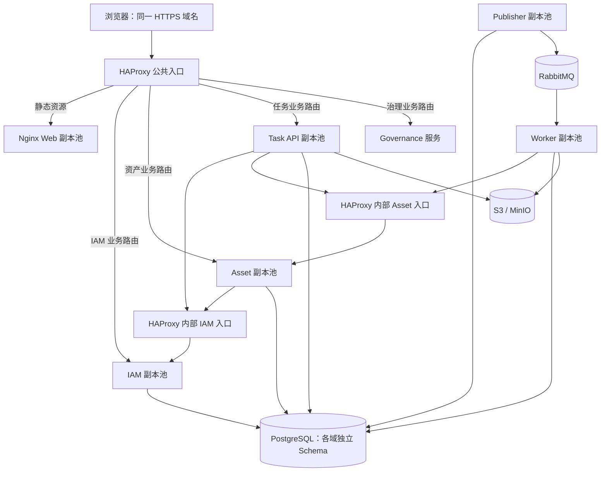

# 负载均衡与多实例改造调研

调研日期：2026-10-24。范围：当前工作区的新平台 `platform/`、`apps/web/`、Compose 和现有验收材料。HEAD 为 `b33392e`，工作区含大量未提交实现，以下判断以调研时实际文件为准，不能仅用该提交复现。旧 Go/SQLite 应用按现有冻结规则继续迁移，不作为本轮扩容对象。

**建议先采用“Compose + HAProxy + HTTP 服务双副本”，完成跨副本正确性和故障切换验证；生产再按故障域升级到跨主机部署或 Kubernetes。** HAProxy Community 负责 API 入口、服务发现和健康摘除，现有 Nginx 继续托管前端；Go Gateway 的纯转发及公共协议行为迁移验收后移除，过渡期可保留。详细比较、选择条件与兼容清单见 [HAProxy 与 Nginx 选型](haproxy-vs-nginx-selection.md)。PostgreSQL、MinIO 已承载共享状态，Publisher/Worker 已有数据库认领和执行租约基础，无须为多实例重写任务中心。

需要先解决 IAM 签名密钥、进程内登录限流、启动迁移、就绪与排空，以及导入同步预检的中断恢复。单纯增加 `--scale` 不能满足这些要求，也不能据此承诺吞吐翻倍。

本次是源码与官方资料调研，新增方案文档；没有启动、重建或停止现有容器，没有执行新的压测或故障注入。下文明确区分源码事实、历史证据和待验证设计。

**现状与改造边界**

| 环节 | 当前依据 | 多实例判断 |
| --- | --- | --- |
| 外部入口 | [compose.yaml](../../compose.yaml) 为 Gateway/Web 分别绑定固定宿主端口；[Web Nginx](../../apps/web/nginx.conf) 使用 `proxy_pass http://gateway:8080` | Gateway/Web 直接扩容会遇到固定端口占用；需由入口代理统一发布端口 |
| Gateway | [main.go](../../platform/cmd/gateway/main.go) 的 `proxyFor` 为每个域创建 `NewSingleHostReverseProxy` | 可以指向一个稳定的服务入口，但自身没有副本注册、逐副本健康检查和调度策略 |
| 服务间访问 | [asset/auth.go](../../platform/internal/asset/auth.go)、任务 API/Worker 使用单个 IAM/Asset URL | 外部请求和内部授权、导入导出调用都应接入相应服务池，不能只给 Gateway 增加负载均衡 |
| IAM 密钥 | [IAM main.go](../../platform/cmd/iam-service/main.go) 的 `loadPrivateKey` 在未配置时生成临时 RSA 密钥；Compose 未注入持久密钥 | A 实例签发的 Token 会被使用另一把密钥的 B 拒绝；这是 IAM 扩容前的阻断项 |
| IAM 会话 | [postgres.go](../../platform/internal/iam/postgres.go) 的 `RotateSession` 使用数据库事务和 `FOR UPDATE` | Refresh Session 已共享，无需粘性会话；仍需处理客户端并发刷新和刷新响应丢失 |
| 登录限流 | [iam/http.go](../../platform/internal/iam/http.go) 使用进程内 map；`clientIP` 读取 `RemoteAddr` | 失败计数随副本拆散，重启清零；经过代理后记录的是上游代理地址 |
| 资产并发写 | [asset/store.go](../../platform/internal/asset/store.go) 使用事务、行锁、版本条件更新，并同事务写版本历史 | 已具备跨进程并发保护；普通创建接口并不因此具备请求重放幂等性 |
| 迁移与初始化 | IAM/Asset 每次 `OpenStore` 都执行 DDL；IAM 启动时先查询再创建管理员；[任务迁移](../../platform/internal/taskcenter/store_migrations.go) 已与运行时拆分 | IAM/Asset 应迁移到显式初始化流程，避免并发启动 DDL 和管理员创建竞争 |
| 健康检查 | [servicekit/http.go](../../platform/internal/servicekit/http.go) 的默认 ready 恒为 200；任务 API、Publisher、Worker 另有检查 | IAM/Asset/Gateway 的 ready 语义需要补齐；现有 Compose healthcheck 不等于请求调度器会摘除坏副本 |
| 任务 API | [taskcenter/service.go](../../platform/internal/taskcenter/service.go) 创建导入后在请求内完成下载、CSV 预检和错误文件写入 | 文件持久化不代表执行可恢复；同步预检仍依赖当前 API 进程存活 |
| Publisher/Worker | [Outbox](../../platform/internal/taskcenter/store_outbox.go) 用 `SKIP LOCKED` 与 claim token；[执行](../../platform/internal/taskcenter/store_execution.go) 用 execution token、租约及数据库时钟 | 可复用已有多消费者设计；消息允许重复，业务副作用由数据库约束和幂等控制 |
| 文件与基础设施 | [object_store.go](../../platform/internal/taskcenter/object_store.go) 使用 S3；Compose 的 PostgreSQL/RabbitMQ/MinIO 各一个实例 | 应用能共享文件和数据，但三项基础设施仍是单点 |

现有 [AMQP 验收记录](amqp-worker-publisher-acceptance.md) 已记载两个 Worker、Publisher 并发认领、重复消息与强杀恢复等证据。这些证据支持复用任务执行基础，但不覆盖本方案的 HTTP 多副本、入口失效、IAM 跨副本刷新和同步预检中断。

现有 [2026-10-19 极限吞吐报告](../testing/extreme-throughput-results-2026-10-19.md) 的口径必须保留：最高已验证稳定负载仍是历史三轮认证的 **320 RPS**；约 **566.47 RPS** 是出现丢迭代和尾延迟超标时的短测成功处理速率。Asset 池达到 10/10 且有明显等待，同机 k6 与 PostgreSQL 竞争 CPU。因此“多实例后 640/1000 RPS 稳定”目前没有证据。

**目标拓扑与选型**



图中的“内部服务入口”是逻辑地址，可由同一 HAProxy 的不同内部监听提供并复用后端池，也可独立部署或在后续采用 Kubernetes Service。实验环境可先复用一个 HAProxy 进程，但仍是单点；内部监听不得发布为公共业务端口。生产应让入口及内部代理本身具备跨主机接管能力，或采用每应用主机本地代理配合冗余后端，不能只复制业务进程。图中为移除 Go Gateway 后的目标结构，迁移期间须逐项保持其公共协议行为。

| 方案 | 适用性与取舍 | 本项目建议 |
| --- | --- | --- |
| HAProxy | 内置主动 HTTP 健康检查；DNS resolver 与 `server-template` 可更新后端地址 | 首选用于 Compose 验证；主动检查正好覆盖本次就绪、摘除、恢复验收 |
| Nginx OSS upstream | 项目已用于前端；动态 DNS 需要正确配置 `resolve`、resolver 和共享 zone；原生周期主动检查属于商业模块 | 接受被动健康检测，或已有平台提供健康端点管理时可选。`resolve` 自 1.27.3 起可用于 OSS；不能凭现有 `1.27-alpine` 标签推断锁定 digest 的具体补丁版本 |
| Kubernetes Service + 入口控制器 | 提供服务地址和端点管理，适合多主机滚动发布；需额外维护集群及控制器 | 已有成熟集群时可直接采用；没有集群时先完成应用改造与 Compose 验证 |
| 在 Go Gateway 内自研负载均衡 | 需自行维护发现、摘除、重试、排空和连接复用；内部调用仍需另一套方案 | 首期不选，收益不足以抵消新增维护成本 |

上述能力依据：[HAProxy 健康检查](https://www.haproxy.com/documentation/haproxy-configuration-tutorials/reliability/health-checks/)、[HAProxy DNS 发现](https://www.haproxy.com/documentation/haproxy-configuration-tutorials/proxying-essentials/dns-resolution/)、[Nginx upstream](https://nginx.org/en/docs/http/ngx_http_upstream_module.html)、[Kubernetes Service](https://kubernetes.io/docs/concepts/services-networking/service/)。选择 HAProxy 是基于本项目现状的工程判断，不是性能实测排名。

初始 HTTP 调度使用 round-robin，不启用粘性会话。文件传输等耗时差异明显的路由可另测 least-connections；算法选择不能解决数据库排队。连接级负载均衡、HTTP keep-alive 和 HTTP/2 都可能造成副本负载不均，必须按实例请求数和连接数验证，不能仅凭 DNS 返回多个 IP 判断已均匀分流。

**必须完成的应用改造**

1. **IAM 使用持久、统一的签名配置。** 通过受保护的文件或 Secret 向 IAM 副本注入同一把 RSA 私钥、issuer、audience；生产模式缺少密钥时启动失败。现有配置加载已支持 `IAM_PRIVATE_KEY_FILE`，主要缺口是部署注入与强制校验。业务服务无需获得私钥。当前 `TokenSigner` 没有 `kid` 和多验证密钥，首期统一密钥，后续再实现新钥签发、旧钥限期验签的轮换；不能滚动发布时让半数实例直接换钥。若从临时密钥切换，需要安排一次重新登录或设计旧钥过渡。

2. **共享登录限流，并建立真实客户端地址的信任边界。** 将“账号＋可信客户端 IP”的失败窗口放入具有原子更新和过期机制的共享存储。首期若希望减少依赖，可评估 PostgreSQL 独立计数表；登录流量大时采用 Redis。需要固定窗口/滑动窗口语义、原子限额判定、过期清理，以及共享存储不可用时的处理规则。保留现有失败次数策略时，还要限制同时进行的登录尝试，避免分开的 `Allow`/`Failed` 被并发穿透。入口清理客户端自带转发头，内部仅信任已配置代理链；不能直接信任任意 `X-Forwarded-For`。单机代理内存限流也不能自动成为多入口全局限流。

3. **修复并发刷新。** Refresh Session 已在 PostgreSQL 中用行锁轮换，但 [client.ts](../../apps/web/src/api/client.ts) 每个遇到 401 的请求都会独立刷新；同一个旧 Refresh Token 再用会撤销整个 family。同页应合并刷新请求，多标签页还需协调刷新或明确重认证行为。刷新请求及其响应丢失不能由代理盲目重放。跨副本测试应分别验证正常轮换、并发刷新和真实重放攻击，不应为避免误判而取消重放检测。

4. **将 IAM/Asset 的迁移和初始化从运行时移出。** 参照任务域增加显式迁移入口、版本/校验和记录及启动版本检查；发布流程只运行一个迁移任务，初始化管理员要有原子幂等保护。现有任务迁移也应单次调度，避免多个初次初始化同时竞争建表。资产性能索引 004/005 当前存在于 `deploy/postgres/migrations/asset/`，不能只迁走嵌入的 001–003 后漏掉既有部署索引。升级先增加兼容结构，再发布新旧可共存的代码，最后独立安排破坏性清理。运行账号与迁移账号逐步分离。

5. **实现可用于调度的就绪状态和排空。** liveness 只检查进程是否可运行，避免依赖故障触发重启风暴。readiness 检查初始化完成、配置有效、未排空；IAM/Asset 增加有界数据库检查。Gateway 不应因任意一个业务域中断而整体下线，应保留其他路由并对故障域返回明确错误。任务 API 目前把 IAM、Asset、MinIO 全部绑定到 ready，需要评估是否会让本可查询的任务列表也一起不可用；共享依赖故障应有按路由的降级/拒绝策略。健康探测应低成本、有短超时、缓存和抖动控制，避免大量副本反复递归探测依赖。

   排空顺序为：设置 draining、ready 返回 503 → 等待代理摘除传播 → 停止接收新请求并等待在途请求 → 关闭连接池。当前 `servicekit.Run` 收到信号后直接 `Shutdown`，没有显式摘流等待。新增 HTTP 的 `DRAIN_DELAY` 与可配置请求超时；容器停机宽限必须大于摘流等待、HTTP shutdown 预算及余量之和。Worker 保留现有独立 drain 与续租流程，当前 60 秒 drain、75 秒 Compose grace 是已有配置，调整前须重新验收。Kubernetes 也需要处理终止端点和存量连接，而不是只配置副本数。[Kubernetes 终止端点说明](https://kubernetes.io/docs/tutorials/services/pods-and-endpoint-termination-flow/)

6. **让导入预检可恢复。** 当前创建导入的 API 会把任务推进为 `running`，但其 `dispatch_version=0`，没有执行租约；恢复器仅扫描 `dispatch_version>0`。在任务落库后、预检完成前强杀 API，可能留下无法自动恢复的 pending/running 任务；再次提交同一幂等键只返回旧任务。现有迁移 `cutover` 在停旧实例后处理遗留任务，不能作为正常在线恢复器反复运行。

   推荐把预检也建模为异步、可认领的执行阶段：API 持久化源文件、任务和预检 Outbox 后返回任务标识；Worker 预检成功后进入 `awaiting_confirmation`；用户确认后才派发正式导入。预检与正式执行使用不同阶段/代次、租约与去重标识，任务类型及 DTO 变更同步修改 OpenAPI 和前端轮询。预检错误报告采用含执行代次或 token 的对象键，只有有效租约持有者能发布结果指针。阶段转换必须校验取消状态、任务所属人与权限，预检重试不能自动触发正式导入。若希望先少改接口，也可保留同步预检并增加独立租约/恢复器，但仍需处理所有中断窗口，复杂度未必更低。

7. **明确写入重试和请求幂等范围。** 资产版本锁可防止覆盖更新，不能防止创建请求重复提交。任务 API 已按 `(requested_by, kind, idempotency_key)` 唯一约束去重，但尚未严格校验同键请求的业务内容一致性；建议加入请求摘要，同键不同资产类型/部门/源文件返回冲突。内部批量导入已有 `(task_id,row_key)` 幂等约束，继续复用。普通创建接口如需支持失败重试，应增加持久化幂等记录并与业务提交处于同一事务。第一期代理关闭写请求的应用层重放；读取可在总 deadline 内有限重试。Refresh、上传、创建及确认等路径逐条定义，不能泛化为“所有 POST 失败换实例”。Go Transport 本身也有条件重试语义，配置幂等头时需同步审查，头字段不会自动实现数据库幂等。[Go 1.25.13 HTTP Transport](https://pkg.go.dev/net/http@go1.25.13#Transport)、[Nginx 上游重试](https://nginx.org/en/docs/http/ngx_http_proxy_module.html#proxy_next_upstream)

8. **统一请求大小、超时及资源限额。** 当前 Gateway/任务 API 的 body 上限是 100 MiB，但通用 HTTP 读写超时为 30 秒；Web Nginx 没有设置 `client_max_body_size`，默认 1 MiB 可能先阻断大文件。应分别定义普通 API、上传、下载的预算，并验证经完整浏览器入口的行为。把预检移出请求后，上传和下载仍可能需要独立超时或流式处理。现有导入 CSV 作为 JSON 字符串传送，要按编码后的请求体计算上限；当前导出会将记录和 CSV 放入内存，Worker 扩容需计入每 slot 峰值内存。只提高代理超时不能解除 Go 服务的 30 秒限制。[Nginx 请求体上限](https://nginx.org/en/docs/http/ngx_http_core_module.html#client_max_body_size)

**负载均衡与部署配置的落点**

建议新增独立实验 Compose 文件和配置目录，使用独立项目名与数据卷。最终 Compose 中只有入口代理对外绑定业务端口；Web 使用容器端口，Go Gateway 在迁移验收后退役，过渡期也只使用容器端口；IAM/Asset/Task API 原本已不发布固定宿主端口。不要给可扩容服务设置固定 `container_name`。覆盖原 Compose 的端口列表时必须检查合并后的实际配置，不能假设写 `ports: []` 一定删除旧映射。

| 调用方 | 目标配置 | 实验目标地址示例 |
| --- | --- | --- |
| 浏览器 | 同域业务路径白名单 | HAProxy 入口 → 对应业务服务池；静态资源 → Nginx Web 池 |
| HAProxy 公共入口 | 按 IAM/Asset/Task 路由选择 backend | 直接调度 `iam-service:8081` / `asset-service:8082` / `task-report-service:8084` 的健康副本 |
| Asset、Task API | `IAM_SERVICE_URL` | `http://service-lb:18081` |
| Task API、Worker | `ASSET_SERVICE_URL` | `http://service-lb:18082` |
| HAProxy 公共入口 | Governance 路由对应 backend | 直接调度 `governance-service:8083`；保留既有域路由 |
| Publisher、Worker | `RABBITMQ_URL` | 初期仍用现有 Broker 服务名，生产改为受支持的冗余入口/连接策略 |

目标结构由入口按业务路径直接调度服务池，API 不经过 Web。上表中的 `service-lb` 可作为提供内部监听的 HAProxy 网络名称；若公共入口与内部代理分开部署，两边都直接维护相应后端池，不把公共请求再绕一次内部代理。Go Gateway 过渡期仍可通过原 `*_SERVICE_URL` 配置访问内部服务入口。Web 的现有 `/api/` 代理配置应同步调整，防止产生指向入口自身的回路或残留绕过路径。静态资源发布要处理旧 HTML 引用旧哈希资源的问题：新旧副本混跑时保留兼容资产集，或将静态文件统一部署到对象存储/CDN。TLS 在入口终止时，保持可信的原始 scheme/host，生产启用 Secure Refresh Cookie，并更新 CORS 域名。

以下仅为 **Asset 内部负载均衡的设计片段**，不是完整部署配置，也未经 `haproxy -c` 或运行测试。完整实现还需补齐入口路由、其他服务池、日志、资源限制、访问边界及镜像版本固定。

```haproxy
defaults
    mode http
    timeout connect 2s
    timeout client 35s
    timeout server 35s
    timeout check 1s
    retries 0

resolvers docker_dns
    nameserver docker 127.0.0.11:53
    accepted_payload_size 8192
    resolve_retries 3
    timeout resolve 1s
    timeout retry 1s
    hold valid 5s

frontend asset_internal
    bind :18082
    default_backend asset_pool

backend asset_pool
    balance roundrobin
    option httpchk
    http-check send meth GET uri /health/ready ver HTTP/1.1 hdr Host asset-service
    http-check expect status 200
    default-server inter 2s fall 3 rise 2
    server-template asset 1-8 asset-service:8082 check resolvers docker_dns init-addr none
```

这里的 `127.0.0.11` 只用于 Docker 自定义网络内的 DNS；`1-8` 是可发现实例数的设计上限，需随容量计划调整。检查周期和阈值是待测初值，不代表承诺 6 秒完成所有故障切换；检查耗时、DNS 更新和已有连接都会影响恢复时间。35 秒也只是普通 HTTP 示例，须与应用 deadline 和文件路径预算共同调整。

Docker 容器重建后可能更换 IP，连接方必须能重新解析和重连。测试应覆盖扩缩容、容器换 IP、DNS 暂时失败、短连接和长连接；不能把服务名发现误当作完整健康调度。[Docker Compose 网络说明](https://docs.docker.com/compose/how-tos/networking/)

`/internal/*`、`/metrics*`、pprof 和代理管理接口不能由公开入口转发；内部代理监听不发布宿主端口，并按网络及服务身份限制访问。HAProxy 源文件只写服务地址，不写密钥。所有副本的配置、契约、镜像版本和时钟应一致，升级期间允许的版本组合要有明确验证。

**数据库、队列与副本资源预算**

IAM/Asset 当前把 `MaxConns` 写死为 10，任务 API/Publisher/Worker 使用 pgxpool 配置默认值或连接串值，没有统一预算。应先为各进程增加可校验的连接池参数，再扩副本；仅修改 IAM/Asset 的连接串池大小会被后面的赋值覆盖。

```text
常态连接上限 = Σ(各进程副本数 × 每副本 MaxConns)
发布峰值上限 = Σ((常态副本 + 临时发布副本) × MaxConns)
数据库预算须覆盖发布峰值、迁移、运维、监控和数据库保留连接。
Worker 总执行槽位 = Worker 副本数 × WORKER_SLOTS
```

例如 IAM/Asset 各 2 副本、各 10 连接，Task API/Publisher/Worker 各 2 副本、各 4 连接，共 64；若五类进程同时各增加一个发布副本，就变为 96。假设数据库总上限为 100，再预留 20 给维护等用途，就已超预算。这里是算例，实际值需要读取目标库配置和测量工作负载；提高 `max_connections` 也会增加资源消耗。[PostgreSQL 16 连接配置](https://www.postgresql.org/docs/16/runtime-config-connection.html)

初次 HTTP 对比固定 Worker 总 slots 为 2，避免同时改变后台数据库压力。随后再比较 1 Worker×2 slots、2 Worker×1 slot、2 Worker×2 slots；前两组用于观察进程隔离和接管，第三组才增加执行并行度。不要一开始同时把所有服务、副本池和 slots 翻倍。

Publisher 可部署 2 副本以覆盖进程故障，继续使用现有数据库认领；Worker 通过同一共享队列竞争消费，无须 HTTP LB 或全局主节点选举。已有恢复器使用 `SKIP LOCKED`，多个副本可协作，但应观察空轮询、恢复扫描与连接池占用。严格保留手动 ACK、每 slot prefetch=1、Confirm 后标记 Outbox、租约 token 检查以及导入行幂等；这些机制提供可重试执行和副作用保护，不应表述为消息恰好投递一次。

当连接数成为主要问题时再评估 PgBouncer；它不提供数据库写能力扩容。若使用事务池，要验证 pgx 的协议级预备语句、迁移、事务及会话状态；当前 PgBouncer 对预备语句的支持依赖相应配置，不能按旧经验一概认定“不支持”。[PgBouncer 功能说明](https://www.pgbouncer.org/features.html)

首期数据库仍走统一主库。读副本会引入复制延迟和读后写一致性问题，尤其是 IAM 权限变更、Refresh Session、任务认领及资产版本校验，不能直接接入通用只读轮询池。先定位慢 SQL、锁/IO/CPU、连接等待和后台干扰，再决定报表等可容忍延迟的路径是否单独读扩展。

**从多副本到生产高可用**

| 部署层级 | 可以验证或改善什么 | 仍需承担的限制 |
| --- | --- | --- |
| 单机 Compose 多副本 | 跨进程正确性、部分进程故障接管、配置和压测方法 | 宿主、Docker、入口、DB、MQ、对象存储仍可一起失效；同机 CPU 不会因副本增加而增多 |
| 跨主机应用副本 + 冗余入口 | 应用主机故障容忍、维护窗口缩小 | 内部代理、数据库、MQ、S3 仍需各自 HA；Compose 单机网络不能直接替代跨主机发现 |
| Kubernetes 或成熟容器平台 | 统一服务发现、调度、滚动发布与监控 | 仍须正确实现 readiness、排空、幂等及数据层 HA；集群本身也有运维成本 |

生产目标建议是至少两个应用故障域，入口使用托管负载均衡或两节点代理配合可靠接管机制；自建 VIP/VRRP 需目标网络支持，不能把两台代理本身当作入口接管方案。副本应分散到不同主机，若要求单节点故障后仍满足在线容量，剩余节点必须有相应余量并实测。

PostgreSQL 应使用明确的主备、主节点发现和防双主机制，独立验证备份恢复、RPO/RTO；仅把两个独立数据库放到轮询后端会破坏一致性。S3 使用有故障域冗余的服务；MinIO 不能通过多个进程共享同一个普通数据目录来扩为集群。Bucket 和 lifecycle 目前在任务 API 启动时通过 `Ensure` 写入，应收敛到部署初始化步骤，并让运行时只校验访问能力，避免滚动版本覆盖不同保留策略。

当前 RabbitMQ 只有一个节点，代码声明 durable queue，但没有显式指定 quorum。应用层两个 Publisher/Worker 并不会复制队列数据。生产如选择 quorum queue，通常以三个独立节点容忍一个成员故障，并验证多数派、存储和连接恢复；队列类型不能靠重声明既有队列原地切换，应设计新队列迁移、绑定与在途消息处理。版本升级与队列迁移单独实施，当前仓库的 RabbitMQ 3.13 镜像不能直接等同于官网当前版本行为。[RabbitMQ Quorum Queues](https://www.rabbitmq.com/docs/quorum-queues)

**实施顺序与回退**

| 阶段 | 交付 | 进入下一阶段的条件 | 回退方式 |
| --- | --- | --- | --- |
| A：固定实验基线 | 独立 Compose 项目、镜像/源码清单、D1 数据快照、连接与 CPU 预算；复跑单副本 | 当前业务及权限正确，负载机资源充足，基线可重复 | 停止本次实验项目，保留证据和卷；不动现有项目 |
| B：应用必要改造 | 固定 IAM 密钥、共享限流、刷新协调、迁移拆分、就绪/排空、可配置池及超时 | 单副本回归通过，所有新增配置有错误启动检查 | 使用兼容旧 Schema 的上一镜像；密钥继续保留 |
| C：任务恢复补齐 | 预检异步化或等价租约恢复、请求摘要、状态/契约更新 | 预检各中断窗口可恢复，确认前无正式导入，重放无重复副作用 | 只回退到兼容新任务阶段的版本；否则先暂停接收并排空/转换任务 |
| D：HTTP 多副本 | HAProxy 公共/内部监听、无固定端口副本、逐实例指标、发布脚本；逐域迁移并退役 Go Gateway | 网关公共协议兼容、IAM/Asset/Task API 跨副本功能、替换 IP、滚动和强杀场景通过 | 路由回切兼容的原 Gateway 或摘除新增副本；保留持久密钥和新数据 |
| E：容量与生产 HA | 单变量性能报告、跨主机部署、数据层恢复演练 | 达到确认的容量/SLO，且单节点失败后的容量与恢复达标 | 流量回切已验证实例组；保留数据，按兼容范围回滚应用 |

可以先在隔离实验中验证无导入场景的双副本路由，但“任务链路故障可恢复”的验收必须等 C 完成。Compose 中的 `--scale` 是扩容工具，不能替代逐实例摘流、等待与替换的发布控制器。发布按域分批进行，先兼容迁移，再启动并验证新副本，最后摘流旧副本；不能通过 `down -v` 或恢复旧数据库快照来回滚线上新写入。

建议拆分的实现文件如下，名称为待新增设计，不表示已经创建：

| 改动范围 | 文件/目录 |
| --- | --- |
| LB 与实验部署 | `deploy/haproxy/`、`deploy/test/compose.multi-instance.yaml`；调整 `compose.yaml` 端口与密钥注入，迁移 Go Gateway 公共行为及 Web API 转发配置 |
| HTTP 生命周期和资源预算 | `platform/internal/servicekit/{config,http,server}.go`，各服务 main，数据库 Store 初始化 |
| IAM 与客户端 | `platform/cmd/iam-service/main.go`、`platform/internal/iam/{http,postgres,token}.go`、`apps/web/src/api/client.ts`、session store |
| 预检恢复及契约 | `platform/internal/taskcenter/`、任务迁移、`api/openapi/v1.yaml`、生成产物和导入页面 |
| 迁移入口 | IAM/Asset 的显式迁移命令、版本记录、部署迁移脚本；纳入已存在的索引迁移 |
| 多实例验收 | `scripts/multi-instance-smoke.ps1`、对应测试、性能脚本的逐实例抓取和结果报告 |

**验收设计**

| 场景 | 必须观察的结果 |
| --- | --- |
| 同一 Token 在 IAM A/B 授权；经不同入口/Asset 调用 | 正常请求不因副本切换出现随机 401；权限变更和用户停用在原有实时授权规则下生效 |
| Refresh 跨副本轮换、同页/多标签页并发、旧 Token 重放 | 正常流程可完成；真正重放仍按规则撤销；响应丢失不靠代理反复重放掩盖 |
| 登录失败分散到多个 IAM 和入口、重启 IAM、伪造转发头 | 全局限额不随副本数放大，来源解析符合信任配置 |
| 两个 Asset 同时修改同一版本 | 一个成功，另一个返回版本冲突；资产与版本历史一致 |
| 同键同内容/不同内容在不同 Task API 提交 | 同内容得到同一个任务；不同内容按新契约冲突；不得重复导入或误复用另一个请求 |
| 源文件写入、任务提交、预检认领、报告写入、状态提交各阶段强杀 API/Worker | 无永久卡死预检；最终状态可解释；确认前无正式导入；迟到执行者不能覆盖有效结果 |
| 2 Publisher + 2 Worker、重复投递、Confirm 后退出、旧租约迟到写回 | 沿用现有幂等与 token 防护，任务最终可恢复；导入数及版本数对账正确 |
| 逐实例重建并更换 IP；扩容、缩容、DNS 短暂失败 | 健康副本继续可用，新副本加入，旧地址退出；记录恢复时间与实例流量分布 |
| SIGTERM 排空与 SIGKILL | 正常发布在预算内完成在途请求；强杀窗口允许明确的失败，但不能重复写入或将失败算成功 |
| IAM/Asset/DB/MQ/S3 分别中断 | 返回明确依赖错误；鉴权失败不放行；故障域之外的路由保持预期可用，恢复后无任务失踪 |
| 入口/内部代理故障与应用主机故障 | 实验环境记录单点限制；生产拓扑验证实际接管、DNS/VIP 收敛及剩余容量 |
| 经 HTTPS 浏览器入口上传和下载 | 大小限制、超时、Cookie、CORS、原始 scheme 正确；验证多 Web 版本静态资产兼容 |
| 所有副本同时冷启动及发布峰值 | 迁移只运行一次、管理员唯一、DB 连接预算未被发布临时副本突破 |

HTTP 故障摘除可以把“10 秒内恢复对健康副本稳定服务”作为第一轮候选门槛，但应按真实网络与检查预算确认；不能要求强杀时零失败。Worker 的 90 秒租约、10 秒恢复扫描及排队/重试时间共同决定接管时延，不能沿用 HTTP 的 10 秒门槛。性能 SLO 和基础设施 RPO/RTO 要在生产环境信息明确后单独确定。

性能验证至少包含下列独立实验；所有容量提升结论必须来自相同业务比例、数据规模和正确性门槛。

| 实验 | 控制变量与目的 |
| --- | --- |
| 单副本直达与单副本经新 LB | 测量代理增加的耗时及资源成本 |
| Asset 1×10 连接 vs 2×5 连接 | 总连接预算和总 CPU/内存预算相同，观察副本本身的影响；需先实现连接池配置 |
| Asset 2×5 vs 2×10 | 单独检验增加连接并行度的收益及对 DB 的影响 |
| 固定 Asset，IAM 1→2 | 单独观察实时授权调用的扩容效果 |
| 固定总预算 vs 新增主机预算 | 区分资源拆分与资源增加；结果分组报告 |
| 在线请求 + 导入/导出 | 验证 Worker 干扰、队列等待和导出内存峰值 |
| 正常双副本 vs 杀掉一个副本 | 验证故障后的实际持续容量，而非只观察请求能否返回 |

先用独立施压机复核 320 RPS 基线，再测 360/400/440 等中间档位及已知失败的 480/520 长测；有余量后再提高目标。沿用历史标准：三轮各 600 秒稳态、drops=0、实际到达率在目标容差内、业务内容与权限检查通过；列表/详情/版本 p95≤500 ms、p99≤1000 ms，搜索/创建/更新 p95≤1000 ms、p99≤2000 ms，非预期错误率<1%。使用相同 D1 起点并明确每轮真实写入带来的数据增长。统计成功 RPS、已发 HTTP 错误、未发出的 dropped iterations、p95/p99，不能用请求全成功掩盖到达率不足。

采集应包含每实例 CPU/RSS、HTTP 在途/请求数、上游耗时、DB 获取等待、SQL 耗时、连接上限与取消、代理队列与失败、Outbox 最老年龄、任务排队及执行时长、租约恢复和 MinIO 传输。Prometheus 直接抓每个实例，不能通过轮询 LB 反复抓不同实例并当作同一个时序；进程 counter/histogram 按实例聚合，重复暴露的数据库总量 gauge 按语义去重。日志增加实例与版本标识并贯通 `X-Request-ID`，禁止把用户或任务 ID 作为无限基数指标标签。

当前尚缺目标主机数量、可用 CPU/内存、网络条件、峰值业务比例、目标持续 RPS 和可接受停机/数据丢失时间。因此本方案给出了实施路径和可验证的设计，副本数与性能结果仍需按目标环境测定。若只希望先验证多实例，优先完成 B/C/D；若目标是生产高可用，E 及入口、数据层故障演练必须一并纳入。
