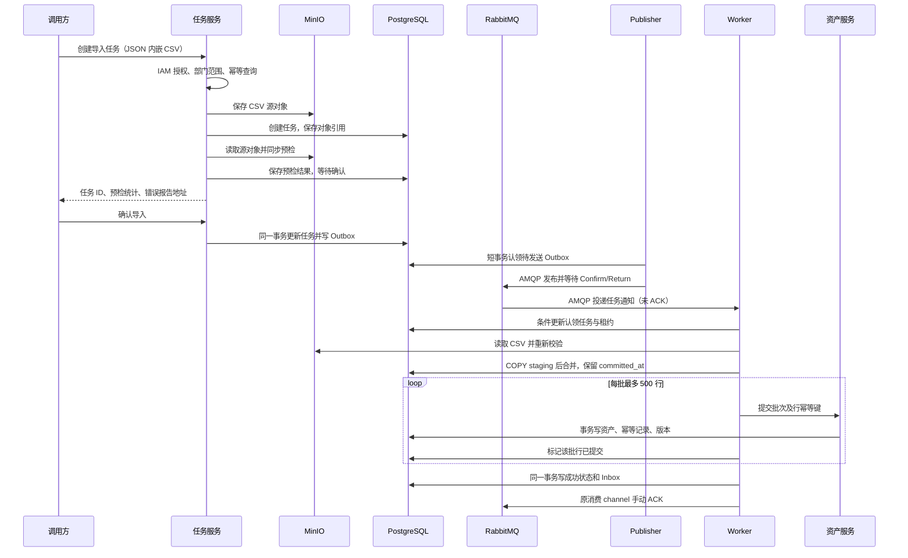

# MinIO 批量导入导出与 Docker Compose 面试问答

核对日期：2026-10-12。依据当前工作区 AMQP 改造代码编写，包括尚未提交的实现。真实 PostgreSQL/RabbitMQ 测试、标准 Compose、基础设施中断和进程强杀验收均通过；10 万行完整导入链路本机单次为19.57秒，提交行和幂等键均为100,000。配置、测量范围与18项证据见 [AMQP 验收记录](../architecture/amqp-worker-publisher-acceptance.md)。历史性能数字不能当作本次 AMQP 的测量结果。

**先统一简历口径。** 新平台使用 PostgreSQL，旧系统使用 SQLite，当前 Compose 没有 MySQL。新平台处理 CSV，尚未实现 XLSX。导入上传、预检同步执行，用户确认后的入库异步执行；导出后台执行。恢复依靠手动 ACK、执行租约和独立恢复器；副作用通过资产行幂等与 token 隔离导出保护。它仍是至少一次投递，需要接受重放。

用户提供的 10 万行 80 秒降至 50 秒，降幅确为 37.5%；仓库[阶段三记录](D:/workspace/assest-manager/docs/phases/phase3-summary.md)另记载一次 18.68 秒验收，未提供与 80/50 秒对应的版本、资源配置和成组原始结果。两组数据不能混为同一实验，也不能仅凭代码断言某项优化贡献了全部降幅。

**1. 请用一分钟介绍这项工作的整体设计。**

“我把任务 API、消息发布和执行拆成独立进程。MinIO 保存 CSV 源文件、错误报告和导出结果；PostgreSQL 保存任务、Outbox/Inbox、执行租约与资产；RabbitMQ 用 AMQP 传递任务通知。API 授权并预检，确认后写任务和 Outbox；publisher 带 Confirm 发布；worker 持续订阅并原子认领任务。

每个 worker 默认两个 slot，每个 slot 手动 ACK、prefetch=1。500 行批次的幂等占位、资产和版本同事务提交；任务完成或可靠安排重试之后才 ACK。导出按执行 token 写不同对象，只有有效执行者可以提交最终结果。”

同一任务的独占执行权来自 PostgreSQL 条件更新和租约校验。发生暂停或网络分区时，旧进程已发出的请求仍可能完成，不能把数据库执行权描述成操作系统层面绝无重叠。

**2. 一次导入请求具体经过哪些步骤？**



创建接口虽然返回 HTTP 202，但返回前已经执行上传和预检，因此应说“确认后的入库异步”，不要说“请求进来立即返回，全部交给后台”。错误报告有逐字段错误时，任务仍可处于待确认状态，但数据库条件会阻止其确认。

依据：[任务创建](D:/workspace/assest-manager/platform/internal/taskcenter/service.go)、[导入 Worker](D:/workspace/assest-manager/platform/internal/taskcenter/worker.go)。

**3. 为什么使用 MinIO？为什么不把文件放数据库或容器本地盘？**

可以回答：

“源文件和导出文件是文件负载，任务状态和对象引用是结构化数据，我把它们分开存储。任务表只保存对象 Key、大小、类型及结果统计，避免把完整 CSV 放进任务 JSONB。MinIO 提供各服务都能访问的对象存储，任务重试也能重新读取同一个源对象。”

如果放容器可写层，重建容器后文件可能丢失；挂卷可以持久化，但跨主机共享和文件访问治理仍需额外设计。数据库当然能够保存文件，选择对象存储是为了分离大文件负载和业务事务职责。

本仓库使用三个前缀：`imports/`、`import-errors/`、`exports/`。源 Key 包含用户 ID、幂等键摘要和内容 SHA-256，不直接使用用户文件名。内容哈希帮助稳定命名，不等于权限控制。

准确边界：只有任务 `input` 不再存 CSV 原文；`task_report.import_rows` 仍保存每行规范化 payload，不能说“整个数据库只存文件元数据”。

**4. 文件预检到底检查什么？为什么导入时还要再校验？**

可以回答：

“预检根据生成的资产 Schema 读取 CSV 表头，拒绝不支持或重复的列，再检查每行列数，转换布尔、整数和小数等类型，调用资产创建校验检查必填、枚举、格式和字段约束。错误记录带行号、字段和原因，编码为 JSONL 后存入 MinIO。只要错误数量不为零，就不能确认入库。”

预检阶段 `keepRows=false`，不保留全部合法行；它仍会累计错误列表。`error_count` 是错误项数量，一行可以对应多项错误，不应直接解释为错误行数。

Worker 重新解析和校验，资产服务也调用 `ValidateCreate`，保证每层都遵守数据约束。预检不能保证执行时数据库约束一定满足，其他请求可能在此期间修改数据。

这是 CSV 内容预检，并非已实现了任意文件格式识别、病毒扫描或 Excel 校验。新平台请求体上限为 100 MiB，限制的是 JSON 请求体整体，不等同于允许上传恰好 100 MiB 的原始 CSV。

依据：[PreflightCSV](D:/workspace/assest-manager/platform/internal/taskcenter/import.go)。

**5. 任务有哪些状态？重复点击确认会怎样？**

导入经过 `pending → running（同步预检）→ awaiting_confirmation → pending → running（异步执行）→ succeeded`。预检的 `dispatch_version=0`，不在 worker 认领和租约恢复范围；用户确认才设置首次调度代次，并与 Outbox 同事务提交。

worker 通过单条条件 `UPDATE ... RETURNING` 把符合代次、到期时间及尝试次数的任务从 pending/failed 认领为 running，生成执行 token 和租约。只有认领成功才增加 attempt；重复通知不会增加尝试次数。

运行中取消仍返回冲突。导入进度根据持有有效 token 的已提交任务行更新；任务结果的 `created/skipped` 表示本次执行，`committed` 表示任务累计提交。

依据：[执行权存储](D:/workspace/assest-manager/platform/internal/taskcenter/store_execution.go)。

**6. 任务已经写进数据库，消息发送失败怎么办？**

“确认导入或创建导出时，任务和 Outbox 在同一个 PostgreSQL 事务提交。独立 publisher 用短事务、SKIP LOCKED 和 claim token 认领事件，再通过 AMQP 持久化消息、mandatory 和 Publisher Confirm 发送。只有 Broker ACK 且消息未被 Return，才按未过期 claim token 回写已发送。”

发送失败记录错误并退避，等待 Confirm 不持有数据库事务。确认发送成功但回写前退出时，同 event ID 可以再次发布，所以消费方仍要幂等。发布进程与执行进程分离，长任务不会阻塞派发循环。

依据：[publisher](D:/workspace/assest-manager/platform/internal/taskcenter/publisher.go)、[AMQP 适配](D:/workspace/assest-manager/platform/internal/taskcenter/broker_amqp.go)。

**7. “分批处理”和“批量写入”有什么区别？代码到底优化了哪里？**

“分批处理决定每次处理多少行，例如 500 行；批量写入决定一批需要多少次数据库交互。循环 500 次 INSERT 即使共用事务，也没有充分减少 SQL 往返。”

| 实现 | 一批主要数据库操作 |
|---|---|
| `CreateBatch` | 每行占幂等键、插资产、查资产、写版本 |
| `CreateBatchFast` | 批量占幂等键并 RETURNING，批量插入获胜资产并 RETURNING，批量写版本 |

快速路径整批校验并拒绝重复 row key，按 key 固定排序降低重叠批次死锁风险。它已删除 advisory lock 和“先查键再写资产”路径，全新批次主要是三组 SQL，不含 BEGIN/COMMIT；唯一键占位、资产、版本同事务提交。

任务行使用 COPY 写 staging 再合并，业务资产使用多值 INSERT。两个资产实现都使用批次事务，因此对比应强调减少批内 SQL 往返，不能虚构成从每行一个事务改成每批一个事务。真实收益需要重新对照测量。

依据：[快速实现](D:/workspace/assest-manager/platform/internal/asset/batch_fast.go)、[任务行合并](D:/workspace/assest-manager/platform/internal/taskcenter/store_execution.go)。

**8. 为什么每批选择 500 行？越大越快吗？**

可以回答：

“500 是当前实现的批次上限，用来平衡数据库往返、事务持续时间、SQL 参数量、内存和失败重试代价。10 万行需要 200 个业务批次，已经能明显减少逐行交互。批次过大，会增大单次请求、参数量和事务开销，也会扩大一次失败需要重做的范围。”

宽表的参数数量近似为“本批行数 × 本批写入列数”，所以不能只按行数判断。还要考虑内部接口请求体限制、索引维护、WAL 和数据库连接池。

若被问“为什么不是 1000”，应回答要用相同数据、资源和正确性约束，比较不同批次下的总耗时、P95 批次耗时、内存和数据库负载。代码没有证明 500 是所有场景的最优值，也没有动态调节批次的实现。

**9. 所谓“事务入库”，是整份文件一个事务吗？**

可以回答：

“当前保证的是每个批次原子提交。一个资产批次里的业务数据、行级幂等记录和版本快照一起成功或一起回滚。前面的批次已经提交后，后面的批次失败，不会回滚整份文件。”

例如第 1～20 批已完成，第 21 批失败，前 1 万条资产会保留。任务重试依靠行级幂等恢复，而不是假装这些资产没有写入。

如果业务要求全文件原子可见，可另外设计按任务隔离的 staging 表，校验完成后在受控事务中合并或发布；这属于扩展方案，并非当前实现。MinIO 操作、任务库标记和资产服务写入之间也没有一个跨服务大事务。

**10. 如何防止重复提交、重复消息和重试产生重复资产？**

“我区分请求、事件、执行权和资产行，它们保护不同位置的重放。”

| 层次 | 当前约束 | 作用 |
|---|---|---|
| 任务请求 | `UNIQUE(requested_by,kind,idempotency_key)` | 同用户同类请求复用任务 |
| 事件 | Inbox `(consumer,event_id)`；执行 Outbox 的任务/代次唯一键 | 重复事件与重复调度去重 |
| 执行 | 条件 UPDATE、worker ID、token、未过期租约 | 只有有效执行者可写状态 |
| 资产行 | `PRIMARY KEY(task_id,row_key)` | 相同行键不重复创建资产 |

资产服务按行键排序后 `INSERT ... ON CONFLICT DO NOTHING RETURNING` 原子占位，只为获胜行写资产和版本。冲突事务会等待竞争者提交或回滚，不依赖 advisory lock。legacy 入口同样按旧主键占位，再同事务写资产与版本。

相同请求幂等键通常返回已有任务，尚未严格比较不同请求内容并报冲突。新 task ID 下的相同业务数据仍需另设业务唯一键。

**11. 资产已提交，但任务服务没收到成功响应，如何恢复？**

“接口超时不能说明数据库没有提交。Worker 重放相同 task ID 和 row key，资产服务原子占位遇到已提交键就跳过，随后任务服务在有效租约下补记 committed_at。”

资产幂等占位、业务资产和版本同事务提交，失败全部回滚。任务行 COPY 到 staging 后合并，保留先前的 committed_at；不再删除整份任务行记录。任务执行仍重新读取、解析并重放所有批次，不是文件字节断点续传。

结果里的 `created/skipped` 是本次执行数量，`committed` 是任务累计提交数量。真实隔离 PostgreSQL 测试已覆盖并发重放和数据库插入失败后的回滚、重试。

**12. 失败如何重试？Worker 宕机也一定能恢复吗？**

“Worker 使用 AMQP 长连接订阅、手动 ACK 与 prefetch=1。执行失败时，先在同一数据库事务中校验有效 token、保存失败或死信、写下一代或 dead Outbox、写 Inbox，提交后再 ACK 原消息。数据库不可用或提交结果不明时关闭原消费 channel，保留 Broker 重投能力。”

默认最多三次业务执行，只有 Claim 成功增加 attempt。worker 每 20 秒续租 90 秒租约；独立恢复器每 10 秒回收过期执行，安排下一代任务或死信。同步预检代次为 0，不会因 running 被误执行。

旧执行者的续租、进度、完成和重试都必须校验 token 与未过期租约；无法确认执行权时停止新增副作用。已发出的远程请求仍可能完成，因此导入还依靠行幂等，导出使用 `exports/{taskId}/{executionToken}.csv`。ACK 丢失后的重放通过 Inbox 和任务终态消重。

依据：[worker](D:/workspace/assest-manager/platform/internal/taskcenter/worker.go)、[执行租约](D:/workspace/assest-manager/platform/internal/taskcenter/store_execution.go)。

**13. 文件上传成功，数据库创建任务失败怎么办？**

可以回答：

“MinIO 和 PostgreSQL 之间没有分布式事务，所以我通过补偿和生命周期处理。先写源对象，再创建任务。创建失败后按请求幂等键回查，如果找到已提交任务就返回它；明确查到没有任务时尝试删除本次对象。如果数据库提交结果不确定、回查也失败，就暂时保留文件，避免误删可能已提交任务引用的对象。”

并发请求使用同一幂等键时，由数据库唯一约束选出唯一任务；竞争对象和胜出任务的源对象不同，才尝试清理竞争对象。部分删除错误被忽略，依靠生命周期兜底，而非保证即时删除成功。

当前默认给源文件、错误报告、导出结果配置 7 天保留期，可以通过 `S3_RETENTION_DAYS` 调整。生命周期与任务状态没有联动，长时间待确认的任务可能遇到源文件过期。改进时应协调任务有效期、重试期限与文件保留期。

依据：[创建与清理](D:/workspace/assest-manager/platform/internal/taskcenter/service.go)、[对象生命周期](D:/workspace/assest-manager/platform/internal/taskcenter/object_store.go)。

**14. 导出如何执行？怎么保证只导出用户有权限的数据？**

可以回答：

“创建导出任务时先通过 IAM 获取权限，把 owner、可访问部门、全局范围和敏感字段权限固化进任务输入。Worker 按这个范围调用资产服务，每页最多查询 5000 行。资产服务把数据范围作为 SQL 条件，并按权限移除敏感字段。然后 Worker 按 Schema 的可导出字段生成带 UTF-8 BOM 的 CSV，上传到 MinIO。”

任务成功结果保存行数、对象 Key 和受保护下载接口。无敏感字段权限时，相应记录字段被删除，CSV 对应单元格为空。

当前是权限快照，不是业务数据快照。查询使用 Offset 分页，没有跨页统一只读快照；导出过程中数据变化可能影响结果一致性。另外先累计全部记录再生成完整 CSV，尚非流式导出。

依据：[导出 Worker](D:/workspace/assest-manager/platform/internal/taskcenter/worker.go)、[分页客户端](D:/workspace/assest-manager/platform/internal/taskcenter/asset_client.go)、[权限映射](D:/workspace/assest-manager/platform/internal/taskcenter/reporting.go)。

**15. 知道下载链接或 taskId，就能下载别人的文件吗？权限变更后呢？**

可以回答：

“下载请求必须经过任务服务。服务重新执行 `asset:read` 授权，再使用任务 ID 和当前用户 ID 一起查询任务；导出还要求任务类型正确并已成功。对象 Key 从数据库结果中取，调用者不能任意指定 MinIO Key。最后服务端读取 MinIO，通过 `io.Copy` 返回文件。”

因此不是依靠 UUID 难猜或隐藏下载按钮控制访问。即使知道别人的任务 ID，带 `requested_by` 的查询也无法返回该任务。错误报告也校验任务归属。

当前没有直接暴露预签名下载链接。代理下载便于每次请求检查身份，但会占用应用服务带宽。

还有一个要分清的边界：下载时重新检查基础读权限和任务归属，没有把文件内容与用户最新部门范围、敏感字段权限重新比对。因此原有权限缩小但仍保留 `asset:read` 的用户，可能仍能获取按旧权限生成的文件。严格撤权可增加授权版本校验，要求文件失效或重新生成；这是待完善方案。

依据：[Download](D:/workspace/assest-manager/platform/internal/taskcenter/reporting.go)、[按所有者查任务](D:/workspace/assest-manager/platform/internal/taskcenter/store.go)。

**16. 80 秒降到 50 秒，37.5% 怎么算？吞吐量提升也是 37.5% 吗？**

按用户提供的数据：

```text
耗时下降 = (80 - 50) / 80 = 37.5%
原平均吞吐 = 100000 / 80 = 1250 行/秒
优化后平均吞吐 = 100000 / 50 = 2000 行/秒
平均吞吐提升 = (2000 - 1250) / 1250 = 60%
```

因此可以说“同规模任务耗时降低 37.5%”，或者“按该耗时计算的平均处理吞吐提高 60%”。不能把两种口径混用，也不能说系统整体性能提升 37.5%。

可用回答模板，前提是确有对应测试记录：

“在同一资源配置、相同 10 万行数据、同一计时范围下，测试耗时从 80 秒降到 50 秒，降低 37.5%。代码层面主要通过 500 行批次、批内集合写入和任务行 COPY 减少数据库交互；各项优化的独立贡献需要分阶段计时或消融实验判断。”

本仓库未找到支撑该组 80/50 秒对照的完整记录，不能补写并不存在的硬件参数、重复次数或 P95 结果。

**17. 面试官问“这 50 秒包含什么”，怎么回答？**

必须按实际实验回答。仓库现有容量脚本的计时口径是：生成 CSV、登录之后启动计时，创建导入任务之前开始，轮询观察到成功或死信后停止。因此包括上传、预检、自动确认请求、排队、Worker 执行和轮询观测延迟；不包括 CSV 生成、登录、后续幂等重放验证和数据库数量对账。

脚本每秒轮询一次，因此终点包含观测延迟；它导入的是两个业务字段的责任部门数据，也不能直接代表宽表、混合错误数据或高并发场景。脚本自动确认，没有人工等待。

要让 80/50 秒更有说服力，应补齐：

- 对比版本、实际调用路径和具体优化差异。
- CPU、内存、磁盘、Docker 资源配额及数据库配置。
- 行数、字段数、文件大小、合法/重复数据比例、已有表规模及索引。
- 完全一致的开始/结束时点、并发数、缓存条件和重复运行方法。
- 总耗时以及解析、排队、数据库、对象存储等阶段耗时。
- 资产数量、幂等键数量、已提交行数量和重复提交结果。

建议进行预热和多轮测量，报告原始结果及中位数；样本足够时再报告 P95。不要把 HTTP 202 返回耗时当成导入完成耗时，也不要将预检单测当成端到端压测。

依据：[容量脚本](D:/workspace/assest-manager/scripts/phase3-capacity.ps1)。

**18. 支持大文件意味着内存使用恒定吗？扩到百万行要改什么？**

可以回答：

“当前 CSV 解析使用 Reader 顺序读取，但全链路仍有全量内存。请求 JSON 已包含完整 CSV；MinIO Put 接受完整字节切片；Worker 预检时保留全部规范化行；任务行 COPY 前再构造全部 values；导出累计全部记录及完整 CSV Buffer。因此当前不能称为恒定内存处理。”

百万行扩展可分阶段设计：预签名上传或流式上传减少 API 承载文件原文；后台预检把错误流式写入报告；使用暂存区协调全文件校验和分批提交；解析、规范化、入库之间用有界缓冲；导出使用稳定键分页或受控快照游标，边读边编码，再流式或分片上传。

这些均为扩展方案。文件名哈希、CSV Reader、每批 500 行三个局部设计，不能自动证明整个服务内存有界。

**19. 用 goroutine 并发导入不是更快吗？当前并发度是多少？**

“当前 worker 是独立进程，默认两个 slot，不同任务可并发；每个 slot 使用独立消费 channel，prefetch=1。相同任务依靠数据库原子认领互斥，批次本身按顺序提交，没有为每行创建 goroutine。publisher 与执行循环分离。”

可通过 WORKER_SLOTS 和 Compose 多实例扩容，但要结合数据库连接池、下游负载、内存和公平性压测。默认并发配置不能证明线性提速，旧版性能数字也不能推算新版容量。

**20. Docker Compose 到底编排了什么？你完成的工作体现在哪里？**

“Compose 定义 PostgreSQL、RabbitMQ、MinIO、前端和七个 Go 运行进程：Gateway、IAM、资产、治理、任务 API、publisher 与 worker，另有一次性 task-migrate。所有 Go 镜像通过 SERVICE 参数复用 Dockerfile。”

task-migrate 先执行任务库迁移，成功退出后三个任务进程启动。API 不依赖 Broker；publisher 只依赖 PostgreSQL/AMQP；worker 依赖数据库、AMQP、资产服务和 MinIO。worker 不映射固定宿主端口，可用 `--scale task-worker=2` 扩容；退出宽限 75 秒覆盖默认 60 秒 drain。

治理服务仍是骨架。容器健康不等于业务成功，还需运行导入、导出、重放、容量与故障验收脚本。

依据：[compose.yaml](D:/workspace/assest-manager/compose.yaml)。

**21. 为什么 Dockerfile 要使用多阶段构建？如何让环境可复现？**

可以回答：

“Go 构建阶段包含编译器和依赖，运行阶段只复制二进制到 Alpine，并以非 root 用户运行。构建使用 `CGO_ENABLED=0`、`-trimpath` 和裁剪调试信息参数。先复制 go.mod/go.sum 下载依赖，再复制源码，有利于复用依赖缓存。”

前端在 Node 阶段执行 `npm ci` 和构建，运行阶段由 Nginx 提供静态资源，也使用非 root 用户。基础镜像固定 digest，依赖使用锁文件，减小版本漂移。

要区分“环境可复现”和“性能实验相同资源”：当前 Compose 没有固定 CPU/内存配额，所以同一份 YAML 不能单独证明两次性能测试拥有相同资源。

依据：[Go Dockerfile](D:/workspace/assest-manager/platform/Dockerfile:1)、[前端 Dockerfile](D:/workspace/assest-manager/apps/web/Dockerfile:1)。

**22. 容器之间怎么通信？为什么不能写 localhost？**

“Compose 默认网络按服务名解析。API 通过 asset-service:8082、minio:9000 和 postgres:5432 访问依赖；publisher 和 worker 使用 RABBITMQ_URL 连接 rabbitmq:5672。容器里的 localhost 指本容器，宿主机只使用映射出来的端口。”

RabbitMQ Management 15672 仅用于管理界面和冒烟只读查询消费者/队列，业务发布和消费使用 AMQP。默认 Web 映射 8088，Gateway 映射 8080；worker readiness 8086 仅在容器网络内探测。

**23. depends_on、healthcheck、restart 分别解决什么？**

“depends_on 描述启动依赖，service_healthy 等待健康，service_completed_successfully 等待 task-migrate 成功退出；healthcheck 判断健康；restart 描述退出后的重启策略。它们各自有边界。”

三个任务进程持续检测所需依赖：API 检查数据库/IAM/资产/MinIO，publisher 检查数据库及发布 channel，worker 检查数据库、订阅和执行依赖。其他服务仍沿用其各自健康实现，不能推断所有进程都具备相同探测。

连接中断由 AMQP supervisor 退避重建，任务通过租约恢复；标记 unhealthy 本身不会自动补偿业务。Rabbit consumer_timeout 明确为 30 分钟，需大于默认 20 分钟任务上限加收尾余量。

**24. 数据持久化、配置和故障排查怎么做？**

“PostgreSQL、RabbitMQ、MinIO 使用命名卷，配置从环境注入。任务库通过一次性 task-migrate 执行登记过的增量迁移，三个任务运行进程只检查 schema 版本；其他领域仍按各自启动迁移逻辑运行。”

排查待执行任务时依次看任务状态/代次/租约、Outbox 最老待发时间与发送错误、AMQP 连接和消费者、源对象、资产幂等键及 committed_at。publisher 日志独立记录发送错误；长时间 running 由恢复器处理过期租约，不能手动绕过 token 改执行结果。

命名卷不是备份，单节点 RabbitMQ 也不是生产高可用。MinIO 仍使用 Root 凭据；最小权限身份、审计、配额与灾备需要继续完善。历史容量数据和本次真实测试必须分别介绍。
**可直接替换的简历表述**

- 基于 MinIO、RabbitMQ 与 PostgreSQL 实现 CSV 导入预检、确认后异步入库及异步导出，支持 500 行批次事务、行级幂等重放、失败重试及按任务归属校验下载权限。
- 使用 Docker Compose 编排 Go 服务、PostgreSQL、RabbitMQ、MinIO 与前端，完成多阶段镜像构建、环境变量配置、健康检查和持久化卷配置。

若有对应的可核验对照记录，可在第一条后增加：“在相同资源配置与 10 万行数据集下，导入耗时由 80 秒降至 50 秒，降低 37.5%。”面试时明确该实验的版本、数据形态和计时范围。
